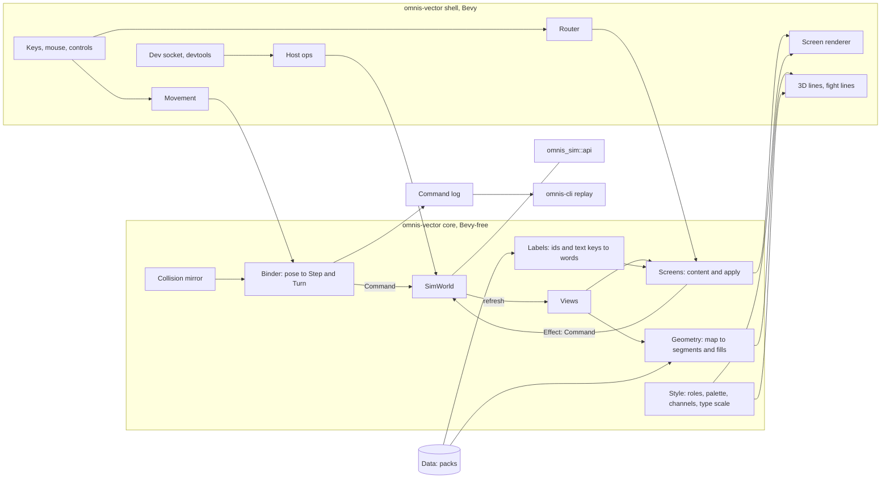

# Omnis — Presentation Architecture

| | |
|---|---|
| Status | v0.4, 2026-10-10 (§6, §10.3, §12, §15.1 brought to the code as built after P2; §4.4, §6.1, §6.3, §6.7, §15.1 after P3; §4.2, §6, §6.1–§6.4, §6.6, §6.7 after P4): rewritten as the game client's architecture (X8, X9, X14), derived from `presentation-PRD.md` v0.3, after parity P0 and P1 (the engine boundary, the dev socket). Adds the screen model (§6), the style system (§7) and the renderer's path to occluding fills, height and shaped structures (§8). Owner decisions this version: screens are descriptions (VA10), rules come from views (VA9). (v0.3, 2026-10-03: the Phase B fight screen as built; v0.2, 2026-10-02: wall height, bloom and packs settled; v0.1: the Phase A experiment, "Omnis Alt") |
| Parent documents | `presentation-PRD.md` (v0.3) for what and why; `ARCHITECTURE.md` (v0.8) for everything not restated here, above all §4.9 (the engine's API), §9 (the dev socket) and A17, A18; `docs/api.md` for the API's reference |
| Owner | gatewaynode |

Decision numbers prefixed X are `presentation-PRD.md`'s; this document's own are VA1 onward (§14). Each
section says whether it describes the code **as built** or a design **to build**, and names the step that
builds it: parity steps P2–P9 (`tasks/TODO.md`, "Vector adoption") or the presentation steps of
presentation-PRD §11.

## 0. Reading order

| Step | Read |
|---|---|
| Any change to the client | §1, §2, §4 |
| P2 title, new game, pause, save and load | §6 (all), §7.5, §10.4, §11 |
| P3 character creation | §4.4 (point buy), §6 |
| P4 town services and the step confirmation | §4.4, §6.6, §6.7 |
| P5 inventory, give and use, spells outside a fight | §4.4, §6 |
| P6 camp and rest, sheet, tactics | §4.4, §6 |
| P7 fight-screen parity | §4.4, §6.5, §9 |
| P8 debug panel, settings | §6, §7.5, §10 |
| P9 retire `omnis-app` | §4.5, §13 |
| Occluding fills (X13, X20) | §8.2, §8.6, §13 |
| Style system (X18, X19) | §7 |
| Height and cliffs (X10, X11, X21) | §5.6, §8.4 |
| Shaped structures (X12) | §8.5 |

## 1. Principles

1. **The simulation is authoritative, through the engine's API only** (ARCH §4.9, A17).
   - `omnis-vector` is a Tier 1 client: it calls `omnis_sim::api` in process. It changes the world only by applying a `Command`, and reads it only through views, Tier 1 queries and the returned `Event`s.
   - The world is private: `sim::SimWorld` holds it, and the library is checked without the `test-fixtures` feature, so a read of a `World` field does not compile (§4.1).
   - The views are read once per change, through one `Session` path, and every screen reads that copy (§4.2).
2. **Rules come from the engine** (VA9). Whether something is allowed, what it costs and what it does come from a view, a trial on a copy of the world (`SimWorld::trial`) or a Tier 1 query. Pack `Data` is read for **labels and catalogues** only: names, text, and the lists a player picks from. When a screen needs a rule the views do not carry, the engine gains it first, as an addition (§4.4).
   - The one standing exception is the predictive collision mirror (§5.4). It copies the step's refusal conditions so free movement can slide along walls, and an exhaustive agreement test holds it to the simulation.
3. **Floats stop at the boundary.** Poses, cameras and geometry are `f32`. What crosses into the simulation is `Command` values, integer enums. `omnis-vector` is not a simulation crate and is not in `scripts/lint-sim.sh`.
4. **A Bevy-free core and a thin Bevy shell.** The binding, collision, geometry, layouts, the fight's action model and every screen's content are plain Rust, tested headless on the real packs. Bevy systems move data between the core and the screen. A screen is a description the core builds and one shell renderer draws (§6, VA10).
5. **Buttons before keys; readable by agents.** Every player action has an on-screen control before it has a key, and keys are shortcuts for controls (PRD §7; no function keys). Every screen's text and controls are listed by `screen.text`, and every screen can be captured (§11).
6. **One style system** (X18, X19). Colour, line pattern, weight, glyph, motion and type size come from `style` (§7). Nothing else in the client names a colour.
7. **Engine additions are tolerated** (ARCH §4.9's stability rules). An event the client does not describe is skipped; a rejection it does not word is shown generically; a new view field is ignored until a screen uses it. The client and the engine build together, so a renamed field fails to compile rather than at run time.

## 2. System overview



## 3. Crate, features and dependencies (as built)

`crates/omnis-vector` (X2, X5) is a library (the core in `src/`, the shell in `src/shell/`) and a binary
(`src/main.rs`).

```toml
[features]
default = ["devtools"]
devtools = ["dep:serde_json"]   # the dev socket (§4.5); compiled out with --no-default-features
test-fixtures = []              # SimWorld derefs to World, for tests only (§4.1)

[dependencies]
omnis-sim = { workspace = true }
serde_json = { workspace = true, optional = true }
bevy = { workspace = true, features = ["2d", "png", "bevy_pbr", "ui"] }

[dev-dependencies]
omnis-vector = { path = ".", features = ["test-fixtures"] }
serde_json = { workspace = true }
```

- **Bevy features** (VA1). `2d` brings `bevy_render`, `bevy_core_pipeline`, `bevy_camera` (with `Camera3d`), `bevy_gizmos`, `bevy_gizmos_render`, `bevy_post_process` and `default_font`. `bevy_pbr` is what compiles the gizmos' 3D pipeline and brings `bevy_light` and `bevy_material`, which the mesh renderer (§8.2) builds on. The `3d` group is not used: it adds glTF, ktx2, zstd and the tonemapping LUTs, and the cameras set `Tonemapping::None`.
- **Adding a Bevy feature** is part of the step that needs it, with the lock's package count and `scripts/check-duplicates.sh` before and after (§13). The mesh renderer is the likely first case.
- **Other dependencies** follow the project's policy (pinned, N−1, older than 30 days, a Socket audit when in doubt; Bevy exempt from N−1). None is planned: `ron` for the command log comes through `omnis-sim`, and the font comes from Bevy until §7.4 decides.
- **Tests** build into one `integration` binary (`autotests = false`, `tests/main.rs`), as every crate's do (`scripts/check-test-modules.sh`).
- **The gate** runs `cargo clippy -p omnis-vector --lib` and `--no-default-features --lib` with `-D warnings` besides the workspace's lints: the library without fixtures, so the private world holds, and without `devtools`, as shipped.

## 4. The engine boundary

### 4.1 `SimWorld` (as built, P0)
`src/sim.rs` keeps the world in `SimWorld(World)`, a private field. Its methods mirror `omnis_sim::api`,
so the client can do only what the API allows:

| Method | API |
|---|---|
| `start(data, seed, settings)`, `new(world)` | `World::new` |
| `apply(data, command)` | `apply` |
| `trial(data, &command)` | `apply` on a clone: what the simulation would answer, with the world untouched |
| `dispatch(data, &op)` | `ops::dispatch`, the Tier 2 protocol in process (the host's mutating and read ops) |
| `here`, `party`, `combat` | `here`, `party_view`, `combat_view` |
| `position`, `exploring_at` | `here().position` turned back into a `Position` through `data.registry.maps`; the second only while exploring |
| `automap(map)`, `door_open(map, x, y, facing)`, `step_lands(data, direction)` | the Tier 1 queries |
| `save_text`, `status`, `check_reload(fresh)`, `replace(world)` | the host ops' engine halves (`ops::save_text`, `ops::status`, `ops::check_reload`) |
| `views(data)` | `Views::of` |

`Deref` and `DerefMut` to `World` exist only under `cfg(any(test, feature = "test-fixtures"))`, for tests that
place the party or plant a state. A new screen that needs another view or query adds a method here, and
nothing else in the client reaches past it.

### 4.2 `Views` and the one refresh path (as built, P0)
`Views { here, position, party, combat, creation, service }` is built by `Views::of` after every change and kept in
`Session.views`. Every screen, the HUD, the renderer and the layouts read that copy; none calls a view
function itself.

- **One path.** `Session::refresh` rebuilds the views. It runs from `Session::note` (after every accepted command: the binder's, a screen's, the socket's), from `Session::replace` (a loaded save, reloaded packs) and from `Session::start`. A test, `the_views_are_the_world_s_after_every_frame`, compares `session.views` with `Views::of` after a walk, a door and a fight.
- **Growth.** A parity step adds the views its screens read: `service` (`service_view`, built in P4: `None` outside a service), `rest` (`rest_view`, P6), `casts` (`cast_view`, P5), `flags` (P8), and `viewport` if the automap needs it (X22). A view used by one rarely open screen may instead be read when that screen's content is built, through a `SimWorld` method, so the per-command refresh stays cheap; the cost decides, measured.
- **Fixtures.** A test that writes the world through the fixture deref calls `session.refresh()` afterwards.

### 4.3 Labels (to build, P2)
The views name definitions by string id and text by key (protocol 2). One Bevy-free module, `labels.rs`,
turns them into words, ported from `omnis-app`'s `defs.rs` and `text::Names`:

- `item`, `spell`, `class`, `race`, `background`, `condition`, `monster`, `map`, `service` look an id up in `data.registry` and return its label through `Data::label("en", key)`.
- **A text key is never shown raw.** `omnis-app` shows `sim:message:nothing_here` on its message line; the vector client looks every `MessageKey` up.
- **Money:** `text::coins` ("15 gp 3 sp 7 cp") for prices and purses, `money::gp_floor` (whole gold, rounded down) where `omnis-app` shows whole gold: the bribe and the victory line.
- **The clock** is worded from `Here.date` (`DateView`: year, day, minute, night) and the calendar's names in `Data`; no rule is involved.
- **Refusals** are worded per `Rejection` variant, with the generic `Display` text as the fallback for a variant the client does not know (§1.7). A blocked step names its reason in words, never `{:?}`.
- Interface strings (menus, captions, help) stay English in the client until the text tables cover them (PRD §11; not scheduled).

The existing `rolllog::Names` (the fight's member and monster names as met) stays; `labels` supplies its
definition names.

### 4.4 Rules the views must carry (to build, per parity step)
`omnis-app` works some rules out from pack data itself. Under VA9 each becomes an engine addition in the
step that first needs it: additive (protocol stays 2), documented in `docs/api.md` §7, and covered by its
drift test and the vocabulary test.

| Rule | `omnis-app` today | Engine addition (shape decided in the step) | Step |
|---|---|---|---|
| Point buy: budget, score range, cost per score | `creation_menu.rs:74-82` reads `rules` values and the `point_cost` table | **Built in P3:** `creation_view(&Data) -> CreationView`, op `creation.get` (docs/api.md §7.9): slots, `name_max`, the score range, `points` and each score's cost, and per race (bonuses, grants), class (`choose`, `skill_list`) and background (grants), read through the functions `party.create` checks with. The client reads it as `Views.creation`; only names come from `Data` | P3 |
| A known spell's point cost and action cost, outside a fight | `sheet_menu.rs:195` reads `point_cost()` | The member's known spells with cost and action cost (`MemberView.spells` holds ids only) | P6 |
| Whether a fight spell is a reaction or a bonus action | `combat_menu.rs:174` compares the spell's `Cost` | `SpellView` gains the action cost, as `FeatureView.pay` has | P7 |
| Whether an item can be used in a fight | `use_menu.rs:103` matches `UseEffect::Sense` to "not here" | The fight's usable items with the engine's refusal, as `FeatureView.blocked` does for features | P7 |

Not additions, because the API already answers them:
- **Saving:** `Here.may_save` (`omnis-app` calls the world's own `may_save`).
- **Casting on the road:** `CastView.refusal`. **Look:** a trial of the sense item's `Use`. **Town offers:** `OfferView` carries the command, price and refusal.
- **The step confirmation's site:** `site_ahead` returns a `ServiceId`, left numeric by design in Tier 1 (ARCH §4.9 rule 5); its name is a label.
- **A monster's size** for its figure is a catalogue fact from `Data`, used for drawing only.

A new screen's review asks the same question of every value it shows: label, catalogue, or rule. A rule
read from `Data` is a defect.

### 4.5 Host operations and the dev socket (as built, P1)
- `shell/host.rs` `handle(session, root, op)` serves the Tier 2 ops for the socket. Read ops go to `SimWorld::dispatch`. Mutating ops (`sim.command`, `sim.script`, `party.create`, `time.reconcile`) go through `dispatch` too, so the rules and replies stay the engine's; their accepted commands (the first `applied` of a script) are then appended to the binder's log, and the session notes the events and snaps the pose when the party's place or facing changed.
- `save.write` and `save.read` go through `game_io.rs`, the path the pause screen uses too; `pack.reload` and `rules.set` use the I/O-free rules in `ops.rs` and replace this game's copy of the packs only (`Session.data` is an `Arc` shared with `Packs` until then). With no game running (the title), every op but `screenshot` and `screen.text` answers "no game is running". A load, a reload or a rule change sets `Session::unreplayable`, because a replay starts from `World::new`; Save log then refuses and says why.
- `screenshot` retargets both cameras to an image the window's size for `LIVE_SETTLE` (4) frames and saves it as an RGB PNG; both targets (`canvas`, `window`) capture what the window shows. `screen.text` walks the UI tree (§10.4).
- `shell/socket.rs` (`devtools` only): loopback only, one client, `MAX_LINE` 1 MiB, newline JSON, `.omnis/dev.addr`; not in `--screenshot` mode. `omnis-app` writes the same address file until P9, so the client started last is the one the bridge finds.

## 5. The grid binding (as built, Phase A; corrected)

Free movement over the authoritative grid (X1). The simulation never sees a continuous coordinate
(presentation-PRD §4). The proof's standalone viewer (X4) is gone: the client starts the world, and from P2
the player does.

### 5.1 Coordinates

| Simulation | World space |
|---|---|
| Cell `(x, y)` | The square `x ≤ X < x+1`, `y ≤ Z < y+1`, centre `geom::cell_centre(x, y)` |
| North (−y), East (+x), South (+y), West (−x) | −Z, +X, +Z, −X |
| Facing | The cardinal nearest the yaw. Yaw 0 looks north; positive yaw turns counter-clockwise seen from above, so +90° looks west (`geom::yaw_of`) |

One cell is 1.0 unit. `geom::wall_height(&Terrain)` returns 1.0 and `EYE_HEIGHT` is 0.5, both provisional
(presentation-PRD §12.8).

### 5.2 The core modules

| Module | Does | Key items |
|---|---|---|
| `geom.rs` | Constants and conversions | `EYE_HEIGHT`, `wall_height`, `cell_centre`, `yaw_of`, `forward`, `right`, `wrap` |
| `grid.rs` | Pure grid maths | `cell_of(x, z)`, `facing_of(yaw, current, margin)`, `nearest`, `relative(heading, facing)`, `rotation(from, to)`, `crossings(from, to, cell, margin)` |
| `pose.rs` | The continuous pose | `Pose { x, z, yaw }`, `Pose::at(Position)`, `Motion { forward, strafe }`, `integrate` |
| `collide.rs` | The collision mirror | `blocks(data, world, map, x, y, facing)`, `clamp(point, cell, radius, blocked)` |
| `bind.rs` | Pose changes to commands, the command log | `Tuning`, `Outcome { pose, events, snapped, frozen }`, `Binder { tuning, log, refusals, disagreements }`: `apply`, `advance(world, data, from, to)`, `settle`, `interact`, `replay` |
| `trial.rs` | A command tried on a copy | `refusal`, `accepted` |

`Tuning` holds the margins: cell-entry hysteresis 0.15, body radius 0.2, yaw hysteresis 5°, sub-step 0.25
of a cell.

### 5.3 Facing, cell entry and diagonals
- **Facing.** `facing_of` keeps the current cardinal until the yaw is more than 45° plus the yaw margin away. A change emits one `Turn` per 90°, before any step of the same frame, so relative steps use the right facing.
- **Cell entry.** The party's cell is the simulation's (`SimWorld::exploring_at`). A crossing is recognised when the pose leaves that cell's square expanded by the margin, and becomes `Step(relative(heading, facing))`.
- **Diagonals.** Motion is sub-stepped (at most 0.25 of a cell), so one sub-step crosses at most two boundaries. `crossings` orders them along the segment (north/south first on an exact corner); if the first is blocked, the pose is clamped and the second re-evaluated.

### 5.4 The collision mirror
`collide::blocks` reproduces the step's refusal conditions in `omnis_sim::apply::move`'s order: the map edge,
a wall, a closed door (`SimWorld::door_open`), a missing cell, impassable terrain. `clamp` keeps the pose a
body radius inside a blocking edge.

The agreement test (`tests/agreement.rs`) places the party on every cell and heading of every loaded map
through the fixture deref, applies `Step` and asserts that `blocks` agrees with `Event::Blocked` or `Moved`,
reason included; door edges are checked closed, then opened with `Interact`, and the test asserts that
service doors were met. A change to the step's rules fails it.

### 5.5 Reconcile and the log
After each `apply`, the first matching rule:

| Observation | Action |
|---|---|
| `Err(Rejection)` | Not logged; the pose is pushed back; `Binder.refusals` counts it (the HUD shows it). A client bug when it happens |
| `Event::Blocked` | The mirror disagreed: the pose is pushed back, `disagreements` counts it. A bug, by the agreement test |
| Two `Moved` (a portal) | The pose snaps to the final cell and facing |
| The party is no longer exploring | Motion freezes and the pose settles in the cell; the fight screen takes over (§9) |
| One `Moved` | The pose is untouched, so movement stays continuous |

`Session::follow` snaps the pose to the party when a command that is not movement moved it (Run, Flee's
retreat), and the socket's host does the same when its command moved or turned the party.

**The log.** Every `Ok` command, blocked steps and party creation included, is appended to `Binder.log`;
refusals never are (VA5). Save log writes `Binder::replay` (`Replay::record`) as RON to the `--log` path
(default `.omnis/vector-session.ron`), and `omnis-cli replay` reproduces the session's fingerprint
(presentation-PRD §4.4).

### 5.6 Height and cliffs (to build, X10, X11)
- **The pose stays `x, z, yaw`.** Height never reaches the simulation. The camera's y is `ground.height(x, z) + EYE_HEIGHT`, from the ground sampler (§8.4).
- **Cliffs block like walls.** They are derived in the engine when the pack loads (X11), so the step refuses with a cliff reason. The mirror gains the same condition, read through a `SimWorld` query rather than recomputed from heights, and the agreement test covers cliff edges.
- **Relief never moves the walkable rule** (XR7): the pose walks the cell grid; the drawn ground only lifts the camera.

## 6. The screen model (as built, P2; VA10)

Every screen outside the 3D view and the fight's line drawing is `bevy_ui` in the neon style (X15), and is
a **description**: plain data the core builds from the views, `Data` (labels) and the screens' own state,
which one shell renderer draws. Built in P2 with the title, the new game's form, the pause, the fallen
party's screen, the square's actions and the town stopgap, which P4 replaced with the service panel; the old centre panel (`panel.rs`, `notice.rs`)
is gone. The fight screen's controls move onto it in P7.

### 6.1 The description
Bevy-free, in `src/screen/` (`mod.rs` the types, one file per screen):

```rust
pub struct Screen {
    pub id: ScreenId,
    pub title: Span,
    pub panels: Vec<Panel>,          // top to bottom; placement beyond the centre comes with P4-P6
    pub keys: Vec<(Key, ControlId)>, // shortcuts (number keys); each names a control on this screen
    pub message: Option<Span>,       // the last outcome (saved, failed to load), from Forms
}
pub struct Panel { pub rows: Vec<Row> }
pub struct Row { pub spans: Vec<Span>, pub controls: Vec<Control>, pub after: Vec<Span> }
pub struct Span { pub text: String, pub role: Role, pub size: Size }      // §7
pub struct Control { pub id: ControlId, pub label: String, pub kind: Kind, pub why_not: Option<String> }
pub enum Kind { Button, Choice { options: Vec<String>, at: usize }, Number { value: i64, min: i64, max: i64 },
                Text { value: String, max: usize } }
```

- **A control is enabled or says why not.** `why_not: Some(reason)` draws it dim as "label: reason" with no `Button`, so it takes no clicks, the way `omnis-app` shows "not enough money" beside a price. The reason comes from the engine (a view, a trial) worded by `labels`.
- **`ControlId` is one enum** across screens (`Action(n)`, `Close`, `Leave`, `NewGame`, `Load`, `Save`, `Seed`, `Rule`, `Offer(n)`, `Amount`, `Deposit`, `Withdraw`, ...), so the router needs no per-screen code.
- **Sizes and colours are roles**, never pixels or literals (§7). `Kind::Number { value, min, max }` (P3) is drawn as its name, arrows and a `bevy_ui_widgets` `Slider`; a slider's move reaches `apply` as `Payload::Set`, and the renderer sets the slider back from the model, so the screen's state stays the one source. A row may carry text after its controls (`Row::after`), and panels lay out side by side.
- **Keys name controls**, so a key can do nothing a button cannot; the renderer prefixes a control's number key to its label.

### 6.2 Apply
`screen::content(id, &Ctx, &Forms) -> Screen` and
`screen::apply(id, &Ctx, &mut Forms, ControlId, &Payload, entropy) -> Result<Effect, Refused>`. `Ctx` holds
the `Data`, the running `Game` (world, views, the fight's log, why the log no longer replays) when there is
one, and the quick save's `Slot` (path, whether it exists). `Forms` holds what screens keep between frames:
the new game's form, the next member's draft, the bank's amount and the last outcome.

```rust
pub enum Payload { Press, Left, Right, Text(String) }
pub enum Effect { None, Command { command, close }, Host(HostOp), Back, Open(ScreenId), ToTitle, Quit }
pub enum HostOp { Restart, NewGame { seed, settings }, Save, Load, SaveLog }
```

- **`apply` refuses before any screen sees the input** (`Refused`): a control not on the screen, a dim one, a payload its kind does not take, text over its limit, a number outside its range. A screen may refuse what was typed too (the bank's amount: `NotDigits`, or `OutOfRange` over `u32::MAX / 100` gold). Any refused text is put back in the field as the form holds it.
- **The outcome.** A command from a screen reports on that screen (P4): the newest event line it added (`Session::ordered`) in the body role, or its refusal in the alert role. `Forms::shown` clears the outcome whenever the top screen changes, and the bank's amount whenever a service is entered.
- A `Command` is offered only when a trial accepts it, so the binder's refusal count stays 0. The shell sends it through `Session::order`, which logs it; `close` says whether the screen closes after it (the square's actions do, an inventory will not).
- `HostOp` is the client's own work. Save and load go through `game_io.rs` (`client_path`, the engine's save rule in `SimWorld::save_text`, the loader's limits, `load_text`), which the socket's `save.write` and `save.read` share. A blank seed takes `entropy`, the clock's nanoseconds mixed by `splitmix64` in the shell, so tests pass a fixed number.

### 6.3 Navigation
`screen::nav::Nav` is a stack of overlays over a **base** that follows the world (`nav::base`), as
`omnis-app`'s `PlayState::for_kind` does (`omnis-app/src/sim.rs:95`):

| Base | When |
|---|---|
| Title | No game (`Session` absent) |
| CreateParty | A new game until Begin (`Nav` keeps `creating`), or any game with no members; decided ahead of Defeat, since an empty party reads as fallen. Esc and Back drop the world and reopen the filled new-game form; pause is not offered. `--seed` starts keep the fixed party |
| none: the 3D view | Exploring: the HUD and the controls |
| Service | `here.service` is set: the service panel (P4). Entering is the engine's (a step onto a site, or Interact) and is not asked; Leave and Esc leave at once |
| none: the fight screen | `views.combat` is `Some` (§9) |
| Defeat | No member can fight (`Views::fallen`): Load last save, Start again, Quit to title |

Overlays: NewGame (over the title), Pause and the square's Actions (P2); Camp, Sheet, Tactics
(P6), Inventory, Cast (P5), Debug, Settings (P8) to come. `Nav::settle` runs every frame and closes what the
world no longer allows: the actions when the party moves or a fight begins, the game's overlays when the game
ends; a new game or a loaded save resets the stack. `Nav::escape` decides Esc: close the top overlay, else
step the fight's menu back when it is not at its first step, else leave party creation or the service (as
the other client's Esc does), else open Pause. In a service the pause is the Menu button's. There is no step
confirmation overlay: the owner dropped it on 2026-10-11 (walking in enters at once, as the engine does). `Nav::paused` is true under
Pause, Defeat and the title: the game's sets do not run (§6.4).

### 6.4 The renderer and the router (shell)
- **The frame.** `VectorSet::Screens` runs after `Grab` and before `Input`, every frame: the router, the renderer, the chrome, the dev socket and the capture. `Grab`, `Input` and `Move` run only while a game runs and no screen holds it (`shell::screen::playing`); `Draw` whenever a game runs, so the scene stays drawn behind Pause.
- **No world until there is one.** `Packs` (the loaded packs and the command line) is always a resource; `Session` exists only while a game runs. The title starts one (`Session::new_game`) or loads one (`Session::loaded`); Quit to title removes it. While none runs, `chrome` hides the HUD's status, the button groups and the minimap.
- **Render.** `shell/screen.rs` draws the top screen under one `ScreenRoot`: a button is a bordered box; a choice its name, two arrow buttons and the current option; a text field its name and an underlined `EditableText` (`bevy_ui_widgets`, part of Bevy's `ui` feature, so no new crate) with `AutoFocus`. It rebuilds the nodes only when the screen's shape (`Screen::shape`: panels, rows, control ids and kinds, which are dim, whether a message shows) or the window height changes, and otherwise rewrites the words and colours in place, so a field keeps its cursor.
- **Scroll.** Each panel is a column with `Overflow::scroll_y`; the mouse wheel scrolls the panel under the cursor (`RelativeCursorPosition`, `ScrollPosition`). The root's height is capped: 64% of the window while a game is played, so a screen sits between the HUD's lines and the button groups, and 95% otherwise (the title, the new game, party creation). A taller screen's panels scroll; nothing marks rows below the fold yet.
- **Glyphs.** The interface font is ASCII only, so screen words use none of "·", "×" or typographic quotes: figures are two spaces apart, as the HUD's are, and counts read "Dagger x2".
- **Route.** One system turns a pressed `Pressable(ControlId)`, a pressed `Arrow`, a changed `EditableText` or a number key into a `Payload`, calls `apply` and carries out the `Effect`. Space, a right click and Shift+Space open the square's actions or run the default one while exploring.
- **Text for agents.** `screen.text` (§10.4) lists every text node, marks buttons and text fields (`[field]`), and shows a dim control as "label: reason", with no per-screen code.

### 6.5 The fight screen
The arena's lines, figures and hit test stay custom (`arena.rs`, `shell/combat.rs`, §9): they are drawn, not
laid out. Its action column, the spell and item pickers, the prompt and the budget line become a `Screen`
whose controls apply through `CombatMenu` (`combat_menu.rs`), so they share the renderer, the router and
`screen.text`. That move is part of P7.

### 6.6 The HUD and the explore screen
The explore base is the 3D view plus descriptions:
- **Status** (as built, `shell/hud.rs`): place, mode and clock, the counts, frame time, the event lines (§10.1).
- **The party column** (built 2026-10-11, owner; the roster band of `omnis-app/src/band.rs`): `screen/roster.rs` describes it Bevy-free, `shell/roster.rs` draws it at the right, under the minimap in explore and at the arena's party rectangle in a fight (§9). Per member in marching order under "front" and "back": an entry button "name  Class level", then "HP h/max" (alert role below a quarter), "SP s/max  AC n", and "down", "dead", or the first condition or effect; the acting member is marked "> " in a fight. Pressing an entry selects the member (again clears it); the selection (`Screens.selected`) is dropped when the member leaves and on every reset (a new game, a load, the title), and is the target P4–P7 use for give and cast. Under the selected member: Sheet, Inventory, Spells, Journal, each opening its screen when that step lands (dim until then: "Not built yet (P5/P6)"; Journal "No quests yet" until quests); in a fight they open read-only (owner: look, don't act; the action column acts). The column's buttons carry `Side`, not `Pressable`, so the top screen's router never sees them; it shows only while a game is played and no screen is up.
- **The message line**: the last event as a long line, refusals in the alert role, cleared on a move. A service's outcomes show on its panel (§6.2, P4); the explore message line stays with P5.
- **The controls** (as built, `shell/controls.rs`): the movement pad bottom left; Actions and Menu (the pause) bottom right. No tool bar (owner, 2026-10-11): Sheet, Inventory and Spells open from the party column; Camp, Look and Map join Actions and Menu at the bottom right when their steps land (P6, P8), each live by `omnis-app/src/tool_bar.rs`'s rules restated on views and trials.

### 6.7 The parity map
What each screen reads, and the details `omnis-app` has that the vector screen must carry. The details are
the parity checklist for each step's plan.

| Screen | Step | Reads | Details to carry over |
|---|---|---|---|
| Title, New game, Load | P2 | `World::new`, `Here.seed`, `Here.settings` | Seed field (blank random, a number as typed, other text hashed, 32 characters); the save rule with its label; permadeath; "Load failed: …" |
| Pause | P2 | `Here.seed`, `Here.settings`, `Here.may_save` | "Seed N", "Saving: … Permadeath: … Devtools: …"; Resume, Save, Load, Sheet, Debug (dim with the reason outside devtools), Quit to title and Quit set apart; "The save rule forbids saving here" / "Saved to …" |
| Defeat | P2 | `party` | "The party has fallen", the last log lines, Load last save, Quit to title |
| Party creation (built, P3) | P3 | names from `Data`, the creation view (§4.4), a trial of `PartyCommand::Create` for Add's reason | Name; race, class, background, alignment; six scores with the running cost "X points spent of Y"; class skill picks "This class picks N skills"; Add member, Begin, Back; "The party is full", "Give the character a name", "Add at least one member". Added in P3: the racial bonus beside each score, and a granted skill dim "from the background"/"from the race" (the other client let it through to the engine's refusal) |
| Step confirmation | dropped | | Not built: the owner's decision of 2026-10-11. Walking onto a site enters at once and Leave leaves at once, without the other client's "Enter the X?" / "Leave the X?" |
| Service panel (built, P4) | P4 | `Views.service` (`OfferView`), `party`, a trial for the bank | The money line "Gold X  Bank Y  Food N" with Leave beside it in the first row (a long list scrolls, so Leave is not last); a panel per list by kind (smith: for sale and your stores; inn, tavern: on offer; temple: on offer and spells; trainer: levels and spell picks; guild: spells), "Nothing to offer" for an empty one; each row's label, a captioned button dim with its reason, and the note (price, "free", "pays X"; a refused purchase keeps its price); the bank's "Gold pieces" field (digits only, at most 8, at most 42,949,672 gold, as its copper fits a `u32`) with Deposit and Withdraw, dim "Type an amount" or the trial's reason; Esc leaves; the outcome on the panel. Added in P4: short reasons where the engine's words name a member by number ("0 of 300 XP", "level 2 spell, up to level 1 now", "the bank holds X") |
| Inventory | P5 | `party` (`ItemView`) | A tab per member and the stores; "wearing …"; rows with count, slot, worn or use mark; equip, use, stow, take, give, each dim when it does not apply; opened from the party column's Inventory (§6.6); the column's selection as the receiver; the messages ("Take it to a member first", …) |
| Cast on the road | P5 | `cast_view` | Caster, spell, "N pt", the refusal dim; "Nobody knows a spell for the road."; opened from the party column's Spells (§6.6); the target is the column's selection or the caster |
| Camp | P6 | `rest_view`, `party` | Per member HP and hit dice with a count capped at `spendable` and its note; short rest; long rest with the food it eats or its refusal; Close |
| Character sheet | P6 | `party`, the known-spell view (§4.4), `Here.mode` | Opened from the party column's Sheet (§6.6), read-only in a fight; Stats, Magic, Gear tabs; member i of n; HP, SP, AC, proficiency, XP and next ("max" at the top); hit dice; "Ready to train"; "Spell picks N"; scores, modifiers, saves, skills, conditions; effects with time left; worn slots and carried items; Tactics (dim in a fight) |
| Tactics | P6 | `MemberView.tactics`, catalogue from `Data` | Member, the reactions switch, declared reactions with Edit and Remove, the form (action, trigger, all or any, conditions), Add, Save, New; "Set elsewhere: it can be removed here, not edited" |
| Fight | P7 | `combat`, `party`, `SpellView`/`FeatureView` with §4.4's additions | Round; the budget line "Action 1 Bonus 1 Reaction 1 (on)"; React toggles reactions; the spell picker's notes (reaction, bonus action, in force, the refusal); the Use picker with features ("1 use", "at will") and items; the disposition worded; "Victory! N XP each, G gold" |
| Debug | P8 | `party`, `here`, `combat`, `flags`, catalogues | Member stats, gold and food, give items, flags, teleport, fight stacks; numbers sent on commit; "dev: …" log lines; devtools only |
| Settings | P8 | client settings (§10.5) | Reduced motion, grid visibility, quality, font, interface scale |

## 7. The style system (to build; X18, X19, presentation-PRD §5, §7)

### 7.1 Roles and channels
A Bevy-free `style.rs`:

```rust
pub enum Role { Structure, Ground, Interactive, Party, Hostile, Magic, Danger, Interface, Dim, Alert }
pub struct Ink { pub rgb: [f32; 3], pub glow: f32 }          // linear; glow > 1 blooms
pub struct Channels { pub pattern: Pattern, pub weight: Weight, pub glyph: Option<Glyph>, pub motion: Motion }
pub struct Palette { /* Role -> Ink, total */ }
pub fn channels(role: Role) -> Channels                       // the same in every biosphere (§5.3)
```

- **The references** are Tron's glowing edges, colour coding and scale and the blueprint's drafting detail (X16); the roles and channels below are how the code carries them.
- **Roles are fixed meanings** (X18). The first set is presentation-PRD §5.2's, plus `Dim` (a control that says why not) and `Alert` (refusals, low HP). The final set is open (presentation-PRD §12.3).
- **Channels do not depend on the biosphere** (X19): pattern (solid, dashed, dotted, sawtooth), weight (hairline to heavy), a glyph from a fixed vocabulary, and motion (pulse, flicker, drift). The enums are open for more.
- **Every drawn thing asks a role.** `geometry::Segment` carries a `Role` instead of an rgb; `arena::Tone` maps to roles; the minimap, the picture window and the UI tokens read the palette. Today's literals, to remove in the style step: `shell/controls.rs` (`GREEN`, `SHADES`, `DIM`), `shell/render.rs` `colour()`, `shell/combat.rs` `colour(Tone)`, `minimap.rs` and `cinema.rs` constants.

### 7.2 Palettes and biospheres
- **A biosphere is a palette** (role → ink) and later a style set, defined in pack data. The data shape is an `omnis-data` schema addition, designed in the style step; until it lands, a built-in default palette (the neon green of the HUD) is used everywhere.
- **Assignment is open** (per region, map or terrain; presentation-PRD §12.2). The client asks for the palette through one function of the views, so changing the rule touches one place.
- A palette is presentation data: it never reaches a rule, and the engine only validates and passes it.

### 7.3 Checks (tests, on every palette in every pack)
- **Contrast:** each role against the ground and against every other role, above a threshold set in the style step (a WCAG-style luminance ratio on the linear values).
- **Colour deficiency:** the same distances under simulated protanopia, deuteranopia and tritanopia (fixed matrices), so no palette collapses two roles for those players (XR8).
- **Channels:** every role has at least one channel besides colour that differs from every other role's.

### 7.4 Type
- A **type scale** of a few named sizes (title, body, small, figure) as fractions of the window's height, so 5120×1440 and 16:9 read alike (presentation-PRD §7). Today's inline sizes (22, 18, 16, 15, 14) go.
- The font is Bevy's default until a modern font is chosen (§15); a font file would be an asset in the repo with its license, not a dependency.

### 7.5 Motion and the settings
Motion is a channel, so reduced motion (§10.5) turns it off for every role at once. The same setting stops
pulsing controls in the UI.

## 8. Rendering

### 8.1 Geometry (as built)
A `Camera3d` with perspective (X3). The whole map is drawn in every direction out to the fog (X6), not
only the simulation's forward cone; the automap still records the cone (§10.2).

`geometry::extract(map, map_id, world)` turns one map into `Segment`s of a `SegKind`:
- **Edges** are deduplicated per line (north and south sides share a row key, east and west a column key), a door on either side winning over a wall. A wall is a rectangle `wall_height` high. A door is a lintel and posts (drawn as wall) and an inner frame, crossed by two diagonals while closed (`SimWorld::door_open`).
- **Cells:** floor lines on each cell's north and west sides; ceiling lines where the terrain has one; a 12-edge box inset 0.1 for a block; a floor cross for impassable ground (`Barrier`).
- Segments are rebuilt when the map changes or `Session.reshape` is set (a door moved, a world replaced).

### 8.2 From gizmos to meshes with occluding fills (to build, X13)
As built, `shell/render.rs` draws every segment with immediate-mode `Gizmos::line` (width 2.0), fading
colour and alpha per segment between half the fog distance and the fog end (the party cell's visibility
depth plus 2). That is see-through wireframe; X13 asks for dark solids that hide what is behind them.

The design fixes the seams; the technique is measured in its step (X20):
- **The core emits fills beside segments.** `extract` gains `Fill`s: the quads of walls, doors, blocks and later shaped structures and terrain, as triangles in the same world space. Fills carry no colour: they are the ground colour, unlit, writing depth.
- **Lines become meshes.** Segments are batched into line meshes per role and depth level, drawn depth-tested against the fills with a small bias so a wall's own edges are not hidden by its face. Pattern and weight (§7.1) are attributes of the line material.
- **The fog moves into the material**, so the per-line alpha loop goes.
- **One swap point.** The renderer behind the `Lines` resource is replaced whole; the core's output, the cameras and the capture do not change. The gizmo renderer is kept until the mesh renderer's capture matches it on the test maps, then removed (VA4 superseded).
- Candidates to measure: `bevy_pbr`'s `StandardMaterial` unlit fills with `LineList` meshes; a custom material for screen-space line width. Bevy features added only if the measurement needs them (§3).

### 8.3 Depth levels (to build, X17)
- **Levels 1 and 2** are one geometry at two densities: level 1 (near the party) draws the full detail — hatching, engraving, glyphs — and level 2 (out to the fog) only main edges. A segment carries its level; the boundary is a distance from the camera, tuned by measurement and possibly a quality setting. A shape fades between levels rather than popping.
- **Level 3** is a backdrop: huge, low-detail forms on a separate camera layer or far plane, moving with the slowest parallax, drawn outdoors only. Where its content comes from is open (presentation-PRD §12.7).
- **Visibility depth** from the terrain still sets the fog end, as built.

### 8.4 Terrain (to build, X10, X21)
- **`Ground`** is a core sampler: `height(x, z) -> f32` = the authored coarse height from the map data (the shape is designed with the mechanics work, presentation-PRD §12.1) plus relief from a seeded noise chosen by terrain kind. The noise is the client's own small function (no dependency), seeded from the map and cell, so the same ground draws the same way every visit.
- **The floor grid** follows the ground like contour lines (X21), in the ground role, hidden by a setting.
- **The camera's y** is the ground's height under the pose plus the eye height (§5.6), smoothed so a step up is not a jolt.
- **Cliffs** are drawn as rock faces in the structure role and block through the engine (§5.6).

### 8.5 Shaped structures (to build, X12)
- **Generators per terrain kind** (jagged rock, broken masonry, rounded towers, trunks and canopies) turn a wall edge or a block cell into segments and fills. They are seeded per cell, so the world is stable between visits.
- **Within the margin.** A shape stays within a margin of its cell edge, so walking against a rock face still feels like the straight edge it collides as (XR7). The margin is a constant tested against the collision body radius.
- **Set pieces** from packs are drawn through the same `Segment` and `Fill` types; their format is open (presentation-PRD §12.4).
- **Doors stay readable:** whatever the generator, a door is drawn in the interactive role with its channels, open and closed distinct (presentation-PRD §6.2).

### 8.6 Cameras (as built) and measurement (to build, X20)
- **The 3D camera:** `Camera3d`, `IsDefaultUiCamera`, `Hdr`, `Tonemapping::None`, `Bloom` (intensity 0.25), a fixed **vertical** field of view of 0.96 rad (`render.rs` `FOV`), near plane 0.02, yaw only, at the eye height. Field of view and eye height for 32:9 and 16:9 are open (presentation-PRD §12.8).
- **The fight camera:** an inactive `Camera2d` (`FightCamera`, `Hdr`, `Bloom`, render layer 1) that takes over in a fight (§9).
- **Measurement.** The offscreen capture (§10.3) gains a timing mode: frames rendered over a fixed walk on the largest test map at 5120×1440 and 1920×1080, reporting mean and worst frame time. Run before and after each renderer step, the numbers go in its review, and the floor is set from them (X20, presentation-PRD §12.6).

## 9. The fight screen (as built, Phase B and V2; corrected)

A separate 2D screen in the vector style replaces the 3D view during a fight (X7).

- **The switch.** `ViewState { Explore, Fight }` (registered by `CombatPlugin`) follows `views.combat.is_some()`; the switch lands a frame later. On entering, `CombatViewPlugin` deactivates the `Camera3d` and activates the `Camera2d`, moving `IsDefaultUiCamera`; the movement pad, the actions button and the minimap hide; the HUD status shrinks to two lines bottom left. On leaving, the cameras swap back, the controls return, `FightRoot` (with `DespawnOnExit`) is despawned, and the pose is already on the party's cell (a retreat lands on the retreat cell).
- **The action model** (`combat_menu.rs`, Bevy-free). `CombatMenu { step }` with `Step::{Top, Spells, Items, Target(Action)}`. In an encounter: Fight, Bribe (with the price in whole gold), Hide, Run. On a member's turn: Attack, Cast, Use, Dodge, Swap, Flee, End turn, with the turn's budget in the prompt. Every entry and target is tried on a copy; a refused one is shown dim with its reason and never sent.
- **The arena** (`arena.rs`): `layout(w, h)` places the left column (the picture window, the action column at least 300 px, the roll log under it at least 80 px, the HUD status at the foot), the party column at the right (24% of the width, 300 to 640 px, above the Menu row; §6.6) and the field between them; `arena(views, data, size, targets, hover)` lays out the figures (monsters in the field's top 55%, the party in two rows; one figure per living individual up to 8, then a count; hp bars); `segments` gives the lines and `pick` the stack or member under a point. The Menu button (the pause: save, load, the log, quitting) stays bottom right in a fight.
- **The roll log** (`rolllog.rs`): one line per fight event, the last 40 in `Session.fight_log`, cleared when monsters are met; `Names` numbers monsters as they were met and keeps the names of members a fight buries.
- **The picture window** (`cinema.rs`, a stub): 492×200, the first standing stack's drawing (every monster is the placeholder rat), fitted in a margin, a dim glow under a bright core.
- **P7 adds:** the controls as a `Screen` (§6.5); React; the Use picker with features and items; the budget line; the spell notes; the additions of §4.4. The art update (animated figures, the screen's scale with the window) fits alongside the style step.

## 10. The HUD, the minimap and the developer tools

### 10.1 The HUD (as built)
`shell/hud.rs` rewrites one status text each frame: the map, cell and facing; the mode and the clock; the
accepted commands, refusals and mirror disagreements; frame rate, frame time and the window's physical
size; the mouse-look hint while it is on; and up to 8 recent event lines (`Session.lines`, worded by
`shell/text.rs`). It becomes the status panel of the explore screen (§6.6).

### 10.2 The minimap (as built) and the automap (to build, X22)
- **As built:** `minimap::paint` (Bevy-free) paints the current map's automap tiles (visited brighter than seen), then walls and doors with canonical edges, and a triangle at the pose pointing along the yaw; `shell/minimap.rs` uploads it as an `ImageNode` top right, repainting only when the map, the command count, the marker's pixel or its heading changes.
- **To build:** a blueprint-style map in the neon style with height as contour lines (X22), opened full-screen from the tool bar's Map. What it records stays the engine's (the cardinal cone); recording the camera's view needs an engine command (presentation-PRD §12.5).

### 10.3 Capture (as built)
- **Offscreen:** `--screenshot PATH [--walk FRAMES] [--size WxH] [--screen title|new-game|pause|actions]` renders without a window (`ScheduleRunnerPlugin`), opens the screen asked for (the title and the form with no game), walks forward, settles 30 frames, saves and exits. §8.6 adds a timing mode.
- **The start.** The window opens at the title; `--seed N`, a capture of the game view, or `--screen pause|actions` start in a game. `--save FILE` names the quick save (default `.omnis/quick.ron`).
- **Live:** the socket's `screenshot` (§4.5).

### 10.4 `screen.text` (as built, P1)
`shell/screen_text.rs` walks the UI tree from its roots, skipping hidden nodes, and prints one line per text:
its rectangle, `[button]` when its parent is a button, and the text quoted. With the renderer (§6.4) it adds
dim controls' reasons and field values.

### 10.5 Settings (to build, P8)
- **Client settings** are the player's, not the world's: reduced motion, grid visibility, quality (depth-level distance, line density, bloom), font and interface scale. They are kept in a small RON file under `.omnis/`, read and validated at start (unknown keys ignored, values clamped), and written by the settings screen. They are never in the save and never reach the simulation.
- The simulation's `Settings` (save rule, permadeath, devtools) are world rules, chosen on the new-game screen (P2) and kept in the save. P2 also gives vector a devtools world in debug builds, as `omnis-app`'s `game_settings` does, so `time.reconcile` and `Dev` commands work over the socket.

### 10.6 The debug panel (to build, P8)
A `Screen` behind `devtools`: member stats, gold and food, items to give, flags, teleport and the fight's
stacks, each sending a `DevCommand` on commit. Opened from Pause; Esc closes it.

## 11. The test and capture contract

Every test runs under `scripts/verify.sh` against the real packs. None is a mock.

**Every screen ships with:**
1. **Model tests**, no Bevy: `content` on the real packs in the states that matter (empty, full, refused), and `apply` for every control, including the refusals of untrusted values.
2. **An app test**, headless (`tests/common/app.rs`: `MinimalPlugins`, `InputPlugin`, `StatesPlugin` and the shell's plugins): every control pressed through the router, every key in its table, and the world checked afterwards. Every offered command is accepted (refusals stay 0).
3. **`screen.text` coverage:** the screen's every control appears in the dump with its label, and a dim one with its reason.
4. **A capture path:** `--screenshot` with `--screen <id>`, so the owner's and agents' captures need no clicking.

**Standing tests:**
- `tests/agreement.rs`, the collision mirror against the step (cliffs too, §5.6).
- `tests/binding.rs`, the binder on the real maps, with the replay proof.
- `the_views_are_the_world_s_after_every_frame`, the one refresh path.
- `tests/socket.rs`, the dev socket over loopback.
- The palette checks (§7.3), once the style system exists.
- In `omnis-mcp`, the vocabulary and `api_doc` tests cover every view addition of §4.4.

**Visual checks** that a test cannot make (the look, the frame rate on the ultrawide) are steps in the
step's acceptance script under `tasks/acceptance/`, with the capture beside them.

## 12. Security

- **Inputs.** Packs, through `omnis_data::load_packs`, which treats them as untrusted (ARCH §6.2). With `devtools`, saves and reloaded packs over the socket, through the same loaders. Saves from the title, the pause and the fallen party's screen (`game_io.rs`, the loader's limits and the engine's migration), and from P8 the client settings file (§10.5), each validated on read.
- **Paths.** `--log` takes a relative path without `..` (`session.rs` `safe_relative`); every socket path goes through `client_path` (relative, no `..`, the extension checked) under the working directory. The quick save (`--save`) is checked by `client_path` when parsed and again on every save and load.
- **The dev socket:** loopback only (a non-loopback `--dev-socket` is refused), one client, 1 MiB per line, compiled out without `devtools`, absent in capture mode (§4.5).
- **Screens.** `apply` clamps and refuses every value a control reports (§6.2). Text fields are bounded.
- **Bounded input.** The mouse delta per frame and the frame's `dt` (0.1 s at most) are clamped before integration, so a stall cannot carry the pose across cells.
- **No `Dev` command** is reachable from player input outside the debug panel, which exists only in `devtools` builds; the agreement test uses the fixture deref.

## 13. Build impact and measurement

Recorded in each step's review:
- the gate's wall time, and the lock's package count with any new package by name and `scripts/check-duplicates.sh`;
- Sentrux (scan `crates/`, rules in `crates/.sentrux/rules.toml`): functions of at most 100 lines, cyclomatic complexity at most 25, no cycles; the quality score before and after;
- for renderer steps, the frame times of §8.6;
- files over 1000 lines are split (`arena.rs` is at 772).

At P9, `omnis-app` and its Feathers dependency leave the workspace; the lock shrinks and the two
address-file writers become one.

## 14. Decisions

| # | Decision | Alternatives | Rationale |
|---|---|---|---|
| VA1 | Bevy features `2d`, `png`, `bevy_pbr`, `ui`; no `3d` group | The full `3d` group | `bevy_pbr` enables the 3D gizmo pipeline and the materials meshes need; `3d` adds glTF, ktx2, zstd and LUTs that lines do not use (§3). |
| VA2 | A Bevy-free core (`grid`, `collide`, `bind`, `geometry`, the layouts, the action model, the screens) and a thin shell | Logic inside Bevy systems | Headless tests on the real maps without a GPU. |
| VA3 | A predictive collision mirror held by an exhaustive agreement test | A world clone per frame; no client collision | A clone per frame is costly and still needs a pose to slide; without collision the pose walks into walls and snaps (§5.4). |
| VA4 | Immediate-mode gizmos with a per-line fade first. **To be superseded** by line meshes over occluding fills (§8.2) | Meshes from the start | It was the least code for the proof. X13 needs depth-writing fills, which gizmos cannot give. |
| VA5 | Log only `Ok` commands, blocked steps included | Log every attempt | A replay fails on a refused command; blocked steps are accepted and move the turn counter. |
| VA6 | Cardinal facing with a hysteresis margin; turns before steps | Facing per step | Relative steps need the right facing; the margin stops `Turn` spam near diagonals. |
| VA7 | Yaw-only camera | Pitch from the start | Yaw maps to facing; pitch adds nothing the grid uses. Revisited with height (presentation-PRD §12.8). |
| VA8 | The engine boundary: a private `SimWorld` mirroring `omnis_sim::api`, one `Views` copy refreshed on every change (§4.1, §4.2) | Read `World` fields; call view functions from each system | ARCH A17. The compiler holds it; one refresh path keeps every screen consistent and the cost known. (P0, 2026-10-10) |
| VA9 | Rules come from views, trials and queries; `Data` for labels and catalogues only (§4.4) | Port `omnis-app`'s derivations from pack data | Owner, 2026-10-10. Rules in the client drift from the engine and cannot be reproduced by a JSON client; each gap becomes an additive engine view. |
| VA10 | Screens are Bevy-free descriptions with an `apply`, drawn by one renderer (§6) | `omnis-app`'s pattern (a model per screen and a Bevy file per screen on a kit); grow vector's `Notice` | Owner, 2026-10-10. Every screen is testable without Bevy, the style guide lives in one renderer, and `screen.text` covers every screen for free. `Notice` cannot express fields, tabs or sheets. |
| VA11 | One style system is the only source of colour, pattern, weight, glyph, motion and type size (§7) | Colours per module, as the proof has | X18, X19: meanings must hold across biospheres and without colour, which only a single source can check. |
| VA12 | The dev socket is hosted by the vector client; socket commands go through `dispatch` and into the binder's log (§4.5) | Keep it in `omnis-app` only; a separate bridge path | So agents drive and capture the client the visual steps change, and a socket-driven session still replays. (P1, 2026-10-10) |

## 15. Open questions

Carried from presentation-PRD §12: height's data shape (1), biosphere assignment (2), the role set and
glyphs (3), the set-piece format (4), the automap's sensing (5), the performance floor (6), the distant
level (7), the camera (8).

This document's own:
1. ~~**Fields in `bevy_ui` without Feathers.**~~ Resolved in P2: Bevy's `ui` feature already compiles `bevy_ui_widgets` (unstyled `EditableText`, `Slider`, `Checkbox`, `ScrollArea`; no new crate). The seed field is an `EditableText`; P3's scores use the slider (with arrows); P4 and P6 the checkbox, styled by the renderer. `TabNavigationPlugin` is not in `DefaultPlugins`, so keyboard focus moves only by `AutoFocus` and clicks until a step adds it.
2. **The font.** Bevy's default until a modern font is chosen with the style step; a font is a licensed asset in the repo.
3. **The line technique** for §8.2 (unlit standard material with line lists, or a custom material for pixel-width lines), decided by measurement.
4. **Where the client settings file lives** for a shipped build (§10.5): `.omnis/` is the development path; the platform's config directory arrives with packaging (M12).
