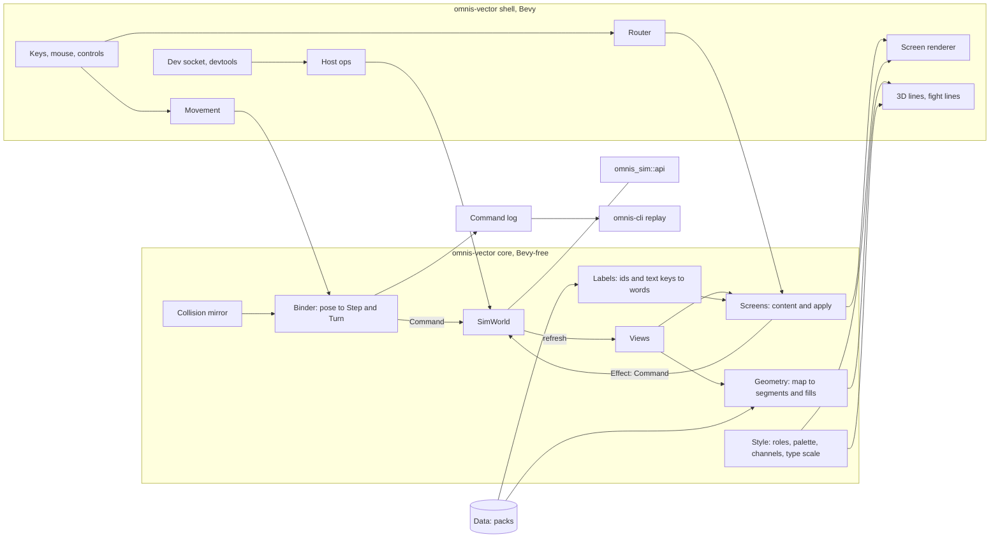

# Omnis — Presentation Architecture

| | |
|---|---|
| Status | v0.4, 2026-10-10 (§6, §10.3, §12, §15.1 brought to the code as built after P2; §4.4, §6.1, §6.3, §6.7, §15.1 after P3; §4.2, §6, §6.1–§6.4, §6.6, §6.7 after P4; §4.2, §4.4, §6.1–§6.4, §6.6, §6.7 after P5; §4.2, §4.4, §6.1, §6.3, §6.4, §6.6, §6.7 after P6; §4.4, §6, §6.1, §6.4, §6.5, §6.7, §9 after P7; §3, §6.1–§6.4, §6.7, §7.4, §7.5, §9, §10.5, §10.6 after P8; §0, §3, §4.5, §6.7, §13 after P9, `omnis-app` retired; §5.6, §8.4 after M8.5 step 1a; §5.2, §5.6, §8.1, §8.4, §10.2 after M8.5 step 4, height drawn; §5.6, §6.6, §7.5, §8.6, §10.5, §12, VA7 after M8.5 step 4b, camera pitch): rewritten as the game client's architecture (X8, X9, X14), derived from `presentation-PRD.md` v0.3, after parity P0 and P1 (the engine boundary, the dev socket). Adds the screen model (§6), the style system (§7) and the renderer's path to occluding fills, height and shaped structures (§8). Owner decisions this version: screens are descriptions (VA10), rules come from views (VA9). (v0.3, 2026-10-03: the Phase B fight screen as built; v0.2, 2026-10-02: wall height, bloom and packs settled; v0.1: the Phase A experiment, "Omnis Alt") |
| Parent documents | `presentation-PRD.md` (v0.3) for what and why; `ARCHITECTURE.md` (v0.8) for everything not restated here, above all §4.9 (the engine's API), §9 (the dev socket) and A17, A18; `docs/api.md` for the API's reference |
| Owner | gatewaynode |

Decision numbers prefixed X are `presentation-PRD.md`'s; this document's own are VA1 onward (§14). Each
section says whether it describes the code **as built** or a design **to build**, and names the step that
builds it: parity steps P2–P9 (`tasks/TODO.md`, "Vector adoption") or the presentation steps of
presentation-PRD §11.

## 0. Reading order

| Step | Read |
|---|---|
| Any change to the client | §1, §2, §4 |
| P2 title, new game, pause, save and load | §6 (all), §7.5, §10.4, §11 |
| P3 character creation | §4.4 (point buy), §6 |
| P4 town services and the step confirmation | §4.4, §6.6, §6.7 |
| P5 inventory, give and use, spells outside a fight | §4.4, §6 |
| P6 camp and rest, sheet, tactics | §4.4, §6 |
| P7 fight-screen parity | §4.4, §6.4, §6.5, §9 |
| P8 debug panel, settings | §6, §7.5, §10 |
| P9 retire `omnis-app` (done 2026-10-11) | §4.5, §13 |
| Occluding fills (X13, X20) | §8.2, §8.6, §13 |
| Style system (X18, X19) | §7 |
| Height and cliffs (X10, X11, X21) | §5.6, §8.4 |
| Shaped structures (X12) | §8.5 |

## 1. Principles

1. **The simulation is authoritative, through the engine's API only** (ARCH §4.9, A17).
   - `omnis-vector` is a Tier 1 client: it calls `omnis_sim::api` in process. It changes the world only by applying a `Command`, and reads it only through views, Tier 1 queries and the returned `Event`s.
   - The world is private: `sim::SimWorld` holds it, and the library is checked without the `test-fixtures` feature, so a read of a `World` field does not compile (§4.1).
   - The views are read once per change, through one `Session` path, and every screen reads that copy (§4.2).
2. **Rules come from the engine** (VA9). Whether something is allowed, what it costs and what it does come from a view, a trial on a copy of the world (`SimWorld::trial`) or a Tier 1 query. Pack `Data` is read for **labels and catalogues** only: names, text, and the lists a player picks from. When a screen needs a rule the views do not carry, the engine gains it first, as an addition (§4.4).
   - The one standing exception is the predictive collision mirror (§5.4). It copies the step's refusal conditions so free movement can slide along walls, and an exhaustive agreement test holds it to the simulation.
3. **Floats stop at the boundary.** Poses, cameras and geometry are `f32`. What crosses into the simulation is `Command` values, integer enums. `omnis-vector` is not a simulation crate and is not in `scripts/lint-sim.sh`.
4. **A Bevy-free core and a thin Bevy shell.** The binding, collision, geometry, layouts, the fight's action model and every screen's content are plain Rust, tested headless on the real packs. Bevy systems move data between the core and the screen. A screen is a description the core builds and one shell renderer draws (§6, VA10).
5. **Buttons before keys; readable by agents.** Every player action has an on-screen control before it has a key, and keys are shortcuts for controls (PRD §7; no function keys). Every screen's text and controls are listed by `screen.text`, and every screen can be captured (§11).
6. **One style system** (X18, X19). Colour, line pattern, weight, glyph, motion and type size come from `style` (§7). Nothing else in the client names a colour.
7. **Engine additions are tolerated** (ARCH §4.9's stability rules). An event the client does not describe is skipped; a rejection it does not word is shown generically; a new view field is ignored until a screen uses it. The client and the engine build together, so a renamed field fails to compile rather than at run time.

## 2. System overview



## 3. Crate, features and dependencies (as built)

`crates/omnis-vector` (X2, X5) is a library (the core in `src/`, the shell in `src/shell/`) and a binary
(`src/main.rs`) named `omnis` since P9 (`[[bin]] name = "omnis"`; `cargo run -p omnis-vector` and
`just run` start it). `--frame-stats` (P9, from the retired client) logs the frame times with vsync off.

```toml
[features]
default = ["devtools"]
devtools = ["dep:serde_json"]   # the dev socket (§4.5); compiled out with --no-default-features
test-fixtures = []              # SimWorld derefs to World, for tests only (§4.1)

[dependencies]
omnis-sim = { workspace = true }
serde = { workspace = true }    # the settings file's derive (§10.5), P8
serde_json = { workspace = true, optional = true }
bevy = { workspace = true, features = ["2d", "png", "bevy_pbr", "ui"] }

[dev-dependencies]
omnis-vector = { path = ".", features = ["test-fixtures"] }
serde_json = { workspace = true }
```

- **Bevy features** (VA1). `2d` brings `bevy_render`, `bevy_core_pipeline`, `bevy_camera` (with `Camera3d`), `bevy_gizmos`, `bevy_gizmos_render`, `bevy_post_process` and `default_font`. `bevy_pbr` is what compiles the gizmos' 3D pipeline and brings `bevy_light` and `bevy_material`, which the mesh renderer (§8.2) builds on. The `3d` group is not used: it adds glTF, ktx2, zstd and the tonemapping LUTs, and the cameras set `Tonemapping::None`.
- **Adding a Bevy feature** is part of the step that needs it, with the lock's package count and `scripts/check-duplicates.sh` before and after (§13). The mesh renderer is the likely first case.
- **Other dependencies** follow the project's policy (pinned, N−1, older than 30 days, a Socket audit when in doubt; Bevy exempt from N−1). `serde` (P8, already in the tree through every simulation crate) derives the settings file's shape; `ron` comes through `omnis-sim` (`omnis_data::ron_io`). No other is planned.
- **Fonts** are assets, not dependencies: Inter and Alegreya Sans (SIL OFL 1.1, `assets/fonts/`, sources and hashes in `assets/README.md`) are compiled into the binary with `include_bytes!` (`shell/fonts.rs`, P8), beside Bevy's built-in font (§7.4).
- **Tests** build into one `integration` binary (`autotests = false`, `tests/main.rs`), as every crate's do (`scripts/check-test-modules.sh`).
- **The gate** runs `cargo clippy -p omnis-vector --lib` and `--no-default-features --lib` with `-D warnings` besides the workspace's lints: the library without fixtures, so the private world holds, and without `devtools`, as shipped.

## 4. The engine boundary

### 4.1 `SimWorld` (as built, P0)
`src/sim.rs` keeps the world in `SimWorld(World)`, a private field. Its methods mirror `omnis_sim::api`,
so the client can do only what the API allows:

| Method | API |
|---|---|
| `start(data, seed, settings)`, `new(world)` | `World::new` |
| `apply(data, command)` | `apply` |
| `trial(data, &command)` | `apply` on a clone: what the simulation would answer, with the world untouched |
| `dispatch(data, &op)` | `ops::dispatch`, the Tier 2 protocol in process (the host's mutating and read ops) |
| `here`, `party`, `combat` | `here`, `party_view`, `combat_view` |
| `position`, `exploring_at` | `here().position` turned back into a `Position` through `data.registry.maps`; the second only while exploring |
| `automap(map)`, `door_open(map, x, y, facing)`, `step_lands(data, direction)` | the Tier 1 queries |
| `save_text`, `status`, `check_reload(fresh)`, `replace(world)` | the host ops' engine halves (`ops::save_text`, `ops::status`, `ops::check_reload`) |
| `views(data)` | `Views::of` |

`Deref` and `DerefMut` to `World` exist only under `cfg(any(test, feature = "test-fixtures"))`, for tests that
place the party or plant a state. A new screen that needs another view or query adds a method here, and
nothing else in the client reaches past it.

### 4.2 `Views` and the one refresh path (as built, P0)
`Views { here, position, party, combat, creation, service, casts, rest }` is built by `Views::of` after every change and kept in
`Session.views`. Every screen, the HUD, the renderer and the layouts read that copy; none calls a view
function itself.

- **One path.** `Session::refresh` rebuilds the views. It runs from `Session::note` (after every accepted command: the binder's, a screen's, the socket's), from `Session::replace` (a loaded save, reloaded packs) and from `Session::start`. A test, `the_views_are_the_world_s_after_every_frame`, compares `session.views` with `Views::of` after a walk, a door and a fight.
- **Growth.** A parity step adds the views its screens read: `service` (`service_view`, built in P4: `None` outside a service), `rest` (`rest_view`, built in P6: each member's hit dice and what a rest would do, with both rests' refusals), `casts` (`cast_view`, built in P5: every member's spells for the road, each with its cost and refusal), `flags` (P8), and `viewport` if the automap needs it (X22). A view used by one rarely open screen may instead be read when that screen's content is built, through a `SimWorld` method, so the per-command refresh stays cheap; the cost decides, measured.
- **Fixtures.** A test that writes the world through the fixture deref calls `session.refresh()` afterwards.

### 4.3 Labels (to build, P2)
The views name definitions by string id and text by key (protocol 2). One Bevy-free module, `labels.rs`,
turns them into words, ported from `omnis-app`'s `defs.rs` and `text::Names`:

- `item`, `spell`, `class`, `race`, `background`, `condition`, `monster`, `map`, `service` look an id up in `data.registry` and return its label through `Data::label("en", key)`.
- **A text key is never shown raw.** `omnis-app` shows `sim:message:nothing_here` on its message line; the vector client looks every `MessageKey` up.
- **Money:** `text::coins` ("15 gp 3 sp 7 cp") for prices and purses, `money::gp_floor` (whole gold, rounded down) where `omnis-app` shows whole gold: the bribe and the victory line.
- **The clock** is worded from `Here.date` (`DateView`: year, day, minute, night) and the calendar's names in `Data`; no rule is involved.
- **Refusals** are worded per `Rejection` variant, with the generic `Display` text as the fallback for a variant the client does not know (§1.7). A blocked step names its reason in words, never `{:?}`.
- Interface strings (menus, captions, help) stay English in the client until the text tables cover them (PRD §11; not scheduled).

The existing `rolllog::Names` (the fight's member and monster names as met) stays; `labels` supplies its
definition names.

### 4.4 Rules the views must carry (to build, per parity step)
`omnis-app` works some rules out from pack data itself. Under VA9 each becomes an engine addition in the
step that first needs it: additive (protocol stays 2), documented in `docs/api.md` §7, and covered by its
drift test and the vocabulary test.

| Rule | `omnis-app` today | Engine addition (shape decided in the step) | Step |
|---|---|---|---|
| Point buy: budget, score range, cost per score | `creation_menu.rs:74-82` reads `rules` values and the `point_cost` table | **Built in P3:** `creation_view(&Data) -> CreationView`, op `creation.get` (docs/api.md §7.9): slots, `name_max`, the score range, `points` and each score's cost, and per race (bonuses, grants), class (`choose`, `skill_list`) and background (grants), read through the functions `party.create` checks with. The client reads it as `Views.creation`; only names come from `Data` | P3 |
| A known spell's point cost and action cost, outside a fight | `sheet_menu.rs:195` reads `point_cost()` | **Built in P6:** `MemberView.known_spells` (`KnownSpellView`: `spell`, `name`, `level`, `cost` from the `spell_points.cost` slot as the cast evaluates it, `pay` the definition's `Cost`), docs/api.md §7.2; `api_views::a_known_spell_costs_what_a_cast_charges_and_pays_its_definition_s_cost`. The fight's `SpellView.cost` read `point_cost()` too (the P5 defect's twin): fixed in P6 through the same helper (`cast_view::cost`; `api_views::a_fight_spell_row_costs_what_the_cost_slot_charges`) | P6 |
| Whether a fight spell is a reaction or a bonus action | `combat_menu.rs:174` compares the spell's `Cost` | **Built in P7:** `SpellView.pay`, the definition's `Cost` (docs/api.md §7.4); `api_views::a_fight_spell_row_pays_its_definition_s_cost`. Whether the bonus action may pay stays `SpellView.bonus` | P7 |
| Whether an item can be used in a fight | `use_menu.rs:103` matches `UseEffect::Sense` to "not here" | **Built in P7:** `CombatView.items` (`FightItemView`: `item`, `name`, `count`, `blocked`), the acting member's kit rows that have a use, each with the refusal `Use` with no receiver would get (docs/api.md §7.4); `api_views::the_fight_s_item_rows_answer_as_the_use_would` | P7 |

Not additions, because the API already answers them:
- **Saving:** `Here.may_save` (`omnis-app` calls the world's own `may_save`).
- **Casting on the road:** `CastView.refusal`. Its `cost` was `Spell::point_cost()` (the spell's `points`, else its level), while the cast charges, and `NotEnoughPoints` reports, the `spell_points.cost` slot; they agreed only because the shipped slot is `spell_level`. Fixed in the engine in P5 (`cast_view` runs `omnis_rules::spell_cost` on a copy of the stream; `api_views::a_cast_row_costs_what_the_cost_slot_charges`; docs/api.md §7.8). **Look:** a trial of the sense item's `Use`. **Town offers:** `OfferView` carries the command, price and refusal.
- **The step confirmation's site:** `site_ahead` returns a `ServiceId`, left numeric by design in Tier 1 (ARCH §4.9 rule 5); its name is a label.
- **A monster's size** for its figure is a catalogue fact from `Data`, used for drawing only.

A new screen's review asks the same question of every value it shows: label, catalogue, or rule. A rule
read from `Data` is a defect.

### 4.5 Host operations and the dev socket (as built, P1)
- `shell/host.rs` `handle(session, root, op)` serves the Tier 2 ops for the socket. Read ops go to `SimWorld::dispatch`. Mutating ops (`sim.command`, `sim.script`, `party.create`, `time.reconcile`) go through `dispatch` too, so the rules and replies stay the engine's; their accepted commands (the first `applied` of a script) are then appended to the binder's log, and the session notes the events and snaps the pose when the party's place or facing changed.
- `save.write` and `save.read` go through `game_io.rs`, the path the pause screen uses too; `pack.reload` and `rules.set` use the I/O-free rules in `ops.rs` and replace this game's copy of the packs only (`Session.data` is an `Arc` shared with `Packs` until then). With no game running (the title), every op but `screenshot` and `screen.text` answers "no game is running". A load, a reload or a rule change sets `Session::unreplayable`, because a replay starts from `World::new`; Save log then refuses and says why.
- `screenshot` retargets both cameras to an image the window's size for `LIVE_SETTLE` (4) frames and saves it as an RGB PNG; both targets (`canvas`, `window`) capture what the window shows. `screen.text` walks the UI tree (§10.4).
- `shell/socket.rs` (`devtools` only): loopback only, one client, `MAX_LINE` 1 MiB, newline JSON, `.omnis/dev.addr`; not in `--screenshot` mode. Since P9 it is the only writer of the address file.

## 5. The grid binding (as built, Phase A; corrected)

Free movement over the authoritative grid (X1). The simulation never sees a continuous coordinate
(presentation-PRD §4). The proof's standalone viewer (X4) is gone: the client starts the world, and from P2
the player does.

### 5.1 Coordinates

| Simulation | World space |
|---|---|
| Cell `(x, y)` | The square `x ≤ X < x+1`, `y ≤ Z < y+1`, centre `geom::cell_centre(x, y)` |
| North (−y), East (+x), South (+y), West (−x) | −Z, +X, +Z, −X |
| Facing | The cardinal nearest the yaw. Yaw 0 looks north; positive yaw turns counter-clockwise seen from above, so +90° looks west (`geom::yaw_of`) |

One cell is 1.0 unit. `geom::wall_height(&Terrain)` returns 1.0 and `EYE_HEIGHT` is 0.5, both provisional
(presentation-PRD §12.8).

### 5.2 The core modules

| Module | Does | Key items |
|---|---|---|
| `geom.rs` | Constants and conversions | `EYE_HEIGHT`, `wall_height`, `cell_centre`, `yaw_of`, `forward`, `right`, `wrap` |
| `grid.rs` | Pure grid maths | `cell_of(x, z)`, `facing_of(yaw, current, margin)`, `nearest`, `relative(heading, facing)`, `rotation(from, to)`, `crossings(from, to, cell, margin)` |
| `pose.rs` | The continuous pose | `Pose { x, z, yaw }`, `Pose::at(Position)`, `Motion { forward, strafe }`, `integrate` |
| `collide.rs` | The collision mirror | `blocks(data, world, map, x, y, facing)`, `clamp(point, cell, radius, blocked)` |
| `ground.rs` | The ground under the view (§8.4) | `Ground::from_map`, `patch`, `height(x, z)`, `joined`, `eye(ground, pose)`, `ease_eye` |
| `bind.rs` | Pose changes to commands, the command log | `Tuning`, `Outcome { pose, events, snapped, frozen, bumped, pressed }` (`bumped`: the side that first holds the pose, once per contact, so the shell can name a cliff's hold), `Binder { tuning, log, refusals, disagreements }`: `apply`, `advance(world, data, from, to)`, `settle`, `interact`, `replay` |
| `trial.rs` | A command tried on a copy | `refusal`, `accepted` |

`Tuning` holds the margins: cell-entry hysteresis 0.15, body radius 0.2, yaw hysteresis 5°, sub-step 0.25
of a cell.

### 5.3 Facing, cell entry and diagonals
- **Facing.** `facing_of` keeps the current cardinal until the yaw is more than 45° plus the yaw margin away. A change emits one `Turn` per 90°, before any step of the same frame, so relative steps use the right facing.
- **Cell entry.** The party's cell is the simulation's (`SimWorld::exploring_at`). A crossing is recognised when the pose leaves that cell's square expanded by the margin, and becomes `Step(relative(heading, facing))`.
- **Diagonals.** Motion is sub-stepped (at most 0.25 of a cell), so one sub-step crosses at most two boundaries. `crossings` orders them along the segment (north/south first on an exact corner); if the first is blocked, the pose is clamped and the second re-evaluated.

### 5.4 The collision mirror
`collide::blocks` reproduces the step's refusal conditions in `omnis_sim::apply::move`'s order: the map edge,
a wall, a closed door (`SimWorld::door_open`), a missing cell, impassable terrain. `clamp` keeps the pose a
body radius inside a blocking edge.

The agreement test (`tests/agreement.rs`) places the party on every cell and heading of every loaded map
through the fixture deref, applies `Step` and asserts that `blocks` agrees with `Event::Blocked` or `Moved`,
reason included; door edges are checked closed, then opened with `Interact`, and the test asserts that
service doors were met. A change to the step's rules fails it.

### 5.5 Reconcile and the log
After each `apply`, the first matching rule:

| Observation | Action |
|---|---|
| `Err(Rejection)` | Not logged; the pose is pushed back; `Binder.refusals` counts it (the HUD shows it). A client bug when it happens |
| `Event::Blocked` | The mirror disagreed: the pose is pushed back, `disagreements` counts it. A bug, by the agreement test |
| Two `Moved` (a portal) | The pose snaps to the final cell and facing |
| The party is no longer exploring | Motion freezes and the pose settles in the cell; the fight screen takes over (§9) |
| One `Moved` | The pose is untouched, so movement stays continuous |

`Session::follow` snaps the pose to the party when a command that is not movement moved it (Run, Flee's
retreat), and the socket's host does the same when its command moved or turned the party.

**The log.** Every `Ok` command, blocked steps and party creation included, is appended to `Binder.log`;
refusals never are (VA5). Save log writes `Binder::replay` (`Replay::record`) as RON to the `--log` path
(default `.omnis/vector-session.ron`), and `omnis-cli replay` reproduces the session's fingerprint
(presentation-PRD §4.4).

### 5.6 Height and cliffs (rules built in M8.5 step 1a, drawing in step 4; X10, X11)
- **The pose stays `x, z, yaw`.** The camera's height never reaches the simulation, which knows the cells' heights only. The camera's y eases toward `ground::eye` (the ground under the pose plus `EYE_HEIGHT`; §8.4, built). The pitch (M8.5 step 4b) is the head's, kept beside the pose in `shell::movement::View`, so the binder and the simulation never see it (VA7).
- **A cliff's hold is named** (built): the mirror holds the pose before the simulation hears of the step, so the binder reports the first contact (`Outcome.bumped`) and the shell shows the engine's own "Blocked: too steep" line, once per contact.
- **Cliffs block like walls** (built). `omnis-data` derives them when the pack loads (`Cell.cliffs`: the difference is more than the entered terrain's `climb` and the edge is no ramp), so the step refuses with `BlockReason::Cliff`. The mirror reads the same `Cell.cliffs` rather than recomputing from heights, and the agreement test covers cliff edges on the engine's elevation fixture.
- **The fog follows the engine's sight** (built): `Views.sight` is the viewport's `visibility_depth`, which counts a light and the party's height (before M8.5 the fog read the floor's depth and ignored a light).
- **Relief never moves the walkable rule** (XR7): the pose walks the cell grid; the drawn ground only lifts the camera.
- **Levels** (built, M8.5 step 1b): the client reads the party's level from the engine (`sim::position` from `Here`), and the mirror reads that level's cells, refusing a step into no ground as the engine does (`BlockReason::NoGround`). A stair or a hole moves the party on the same cell, so the pose stays and only the drawn level and the camera's height change; the agreement test runs on every level of every map, the engine's tower fixture among them.

## 6. The screen model (as built, P2; VA10)

Every screen outside the 3D view and the fight's line drawing is `bevy_ui` in the neon style (X15), and is
a **description**: plain data the core builds from the views, `Data` (labels) and the screens' own state,
which one shell renderer draws. Built in P2 with the title, the new game's form, the pause, the fallen
party's screen, the square's actions and the town stopgap, which P4 replaced with the service panel; the old centre panel (`panel.rs`, `notice.rs`)
is gone. The fight screen's controls moved onto it in P7 (§6.5).

### 6.1 The description
Bevy-free, in `src/screen/` (`mod.rs` the types, one file per screen):

```rust
pub struct Screen {
    pub id: ScreenId,
    pub title: Span,
    pub panels: Vec<Panel>,          // top to bottom; placement beyond the centre comes with P4-P6
    pub keys: Vec<(Key, ControlId)>, // shortcuts (number keys); each names a control on this screen
    pub message: Option<Span>,       // the last outcome (saved, failed to load), from Forms
}
pub struct Panel { pub rows: Vec<Row> }
pub struct Row { pub spans: Vec<Span>, pub controls: Vec<Control>, pub after: Vec<Span> }
pub struct Span { pub text: String, pub role: Role, pub size: Size }      // §7
pub struct Control { pub id: ControlId, pub label: String, pub kind: Kind, pub why_not: Option<String> }
pub enum Kind { Button, Choice { options: Vec<String>, at: usize }, Number { value: i64, min: i64, max: i64 },
                Text { value: String, max: usize } }
```

- **A control is enabled or says why not.** `why_not: Some(reason)` draws it dim as "label: reason" with no `Button`, so it takes no clicks, the way `omnis-app` shows "not enough money" beside a price. The reason comes from the engine (a view, a trial) worded by `labels`.
- **`ControlId` is one enum** across screens (`Action(n)`, `Close`, `Leave`, `NewGame`, `Load`, `Save`, `Seed`, `Rule`, `Offer(n)`, `Amount`, `Deposit`, `Withdraw`, `Owner`, `Item { at, act }`, `Cast(n)`, `Dice(n)`, `ShortRest`, `LongRest`, `Page`, `Tactics`, `Tactic(act)`, `Fight(FightAct)`, `Setting(Field)`, `Apply`, `Settings`, `Debug(DebugAct)`, `OpenDebug`, ...; `Member(id)` and `Tool` are the party column's, routed apart, §6.6), so the router needs no per-screen code.
- **Sizes and colours are roles**, never pixels or literals (§7). `Kind::Number { value, min, max }` (P3) is drawn as its name, arrows and a `bevy_ui_widgets` `Slider`; a slider's move reaches `apply` as `Payload::Set`, and the renderer sets the slider back from the model, so the screen's state stays the one source. A row may carry text after its controls (`Row::after`), and panels lay out side by side.
- **Keys name controls**, so a key can do nothing a button cannot; the renderer prefixes a control's number key to its label.

### 6.2 Apply
`screen::content(id, &Ctx, &Forms) -> Screen` and
`screen::apply(id, &Ctx, &mut Forms, ControlId, &Payload, entropy) -> Result<Effect, Refused>`. `Ctx` holds
the `Data`, the running `Game` (world, views, the fight's log, why the log no longer replays) when there is
one, the quick save's `Slot` (path, whether it exists), the player's settings as applied (`prefs`) and the largest interface scale the window holds (`fits`, §10.5). `Forms` holds what screens keep between frames:
the new game's form, the next member's draft, the bank's amount, the last outcome, the party column's selection (`selected`: who receives a give, a potion or a spell) and whose kit, spells, sheet or tactics a screen shows (`owner`); the camp's hit dice counts (`dice`), the sheet's page (`page`) and the reaction the tactics screen is writing (`tactics`), the last two cleared with the outcome when the top screen changes; the fight's menu (`fight`, P7); the settings draft (`settings`, dropped when the top screen changes, P8) and the debug panel's picks and typed numbers (`debug`, reset with the game; an accepted dev command clears its field's edit, `Forms::accepted`, P8).

```rust
pub enum Payload { Press, Left, Right, Text(String) }
pub enum Effect { None, Command { command, close }, Host(HostOp), Back, Open(ScreenId), ToTitle, ToNewGame, Quit,
                  Settings(Prefs) }   // P8: the shell applies them and writes the settings file
pub enum HostOp { Restart, NewGame { seed, settings }, Save, Load, SaveLog }
```

- **`apply` refuses before any screen sees the input** (`Refused`): a control not on the screen, a dim one, a payload its kind does not take, text over its limit, a number outside its range. A screen may refuse what was typed too (the bank's amount: `NotDigits`, or `OutOfRange` over `u32::MAX / 100` gold). Any refused text is put back in the field as the form holds it.
- **The outcome.** A command from a screen reports on that screen (P4): the newest event line it added (`Session::ordered`) in the body role, or its refusal in the alert role. `Forms::shown` clears the outcome whenever the top screen changes, and the bank's amount whenever a service is entered.
- A `Command` is offered only when a trial accepts it, so the binder's refusal count stays 0. The shell sends it through `Session::order`, which logs it; `close` says whether the screen closes after it (the square's actions do, an inventory will not).
- `HostOp` is the client's own work. Save and load go through `game_io.rs` (`client_path`, the engine's save rule in `SimWorld::save_text`, the loader's limits, `load_text`), which the socket's `save.write` and `save.read` share. A blank seed takes `entropy`, the clock's nanoseconds mixed by `splitmix64` in the shell, so tests pass a fixed number.

### 6.3 Navigation
`screen::nav::Nav` is a stack of overlays over a **base** that follows the world (`nav::base`), as
`omnis-app`'s `PlayState::for_kind` does (`omnis-app/src/sim.rs:95`):

| Base | When |
|---|---|
| Title | No game (`Session` absent) |
| CreateParty | A new game until Begin (`Nav` keeps `creating`), or any game with no members; decided ahead of Defeat, since an empty party reads as fallen. Esc and Back drop the world and reopen the filled new-game form; pause is not offered. `--seed` starts keep the fixed party |
| none: the 3D view | Exploring: the HUD and the controls |
| Service | `here.service` is set: the service panel (P4). Entering is the engine's (a step onto a site, or Interact) and is not asked; Leave and Esc leave at once |
| none: the fight screen | `views.combat` is `Some` (§9) |
| Defeat | No member can fight (`Views::fallen`): Load last save, Start again, Quit to title |

Overlays: NewGame (over the title), Pause and the square's Actions (P2); Inventory and Cast (P5); Camp,
Sheet, Tactics (P6); Settings and Debug (P8). Settings opens from the title and the pause wherever the pause is allowed; Debug from the pause's Debug or backtick, while the base is none (exploring, an encounter, a fight) or a service, in a devtools world of a `devtools` build (`debug::unavailable`); both are in `paused`. Inventory, Cast and the Sheet open from the party column
(`Nav::show`, which replaces whatever stands beside the column), are allowed while the base is none (exploring, or a
fight, where they only look) and never over a service. Camp is allowed only while exploring (not in a service, where the room is the rest indoors, nor a fight; an ambush closes it). Tactics opens over the Sheet (`Effect::Open`) outside a fight, so Close and Esc return to the Sheet. `ScreenId::beside_column` names the screens the column stands beside: Inventory, Cast, Camp, Sheet, Tactics. `Nav::settle` runs every frame and closes what the
world no longer allows: the actions when the party moves or a fight begins, the game's overlays when the game
ends; a new game or a loaded save resets the stack. `Nav::escape` decides Esc: close the top overlay, else
step the fight's menu back when it is not at its first step, else leave party creation or the service (as
the other client's Esc does), else open Pause. In a service the pause is the Menu button's. There is no step
confirmation overlay: the owner dropped it on 2026-10-11 (walking in enters at once, as the engine does). `Nav::paused` is true under
Pause, the screens beside the column, Defeat and the title, so the party cannot walk or meet monsters with a kit open: the game's sets do not run (§6.4).

### 6.4 The renderer and the router (shell)
- **The frame.** `VectorSet::Screens` runs after `Grab` and before `Input`, every frame: the router, the renderer, the chrome, the dev socket and the capture. `Input` and `Move` run only while a game runs and no screen holds it (`shell::screen::playing`); `Grab` every frame, so a screen opened by a key while the mouse looks still takes the pointer back; `Draw` whenever a game runs, so the scene stays drawn behind Pause. The screens' layer carries `GlobalZIndex(1)` and draws over the HUD, the column, the buttons and the fight screen, which carry none.
- **No world until there is one.** `Packs` (the loaded packs and the command line) is always a resource; `Session` exists only while a game runs. The title starts one (`Session::new_game`) or loads one (`Session::loaded`); Quit to title removes it. While none runs, `chrome` hides the HUD's status, the button groups and the minimap.
- **Render.** `shell/screen.rs` draws the top screen under one `ScreenRoot`: a button is a bordered box; a choice its name, two arrow buttons and the current option; a text field its name and an underlined `EditableText` (`bevy_ui_widgets`, part of Bevy's `ui` feature, so no new crate) with `AutoFocus`. It rebuilds the nodes only when the screen's shape (`Screen::shape`: panels, rows, control ids and kinds, which are dim, whether a message shows) or the window height changes, and otherwise rewrites the words and colours in place, so a field keeps its cursor.
- **Scroll.** Each panel is a column with `Overflow::scroll_y`; the mouse wheel scrolls the panel under the cursor (`RelativeCursorPosition`, `ScrollPosition`). The root's height is capped: 64% of the window while a game is played, so a screen sits between the HUD's lines and the button groups, and 95% otherwise (the title, the new game, party creation). A taller screen's panels scroll, and each shows a scrollbar at its right while its rows run past its foot (owner, 2026-10-11): a `bevy_ui_widgets` `Scrollbar` aimed at the panel, its thumb the share in view, drawn by `screen_draw::bars` from the panel's `ComputedNode` and hidden when the rows fit; its gutter is kept either way, so showing it never moves the rows. The thumb can be dragged and the track clicked.
- **Beside the column.** While the party column stands beside a screen (§6.6, `ScreenId::beside_column`), its paint writes its width plus margins to the `Beside` resource, and `make_room` pads the screen layer's right side by it, so the screen centres in the room left of the column. 0 otherwise.
- **Scale and font** (P8, §10.5). Bevy's `UiScale` carries the interface scale to every interface length and text; `shell/settings.rs::apply_scale` sets it each frame to the chosen scale held to what the window holds (`settings::fits`). One system (`shell/fonts.rs::wear`) puts the chosen face on every `TextFont` whose face differs, new text included, so no spawn site names a font.
- **Glyphs.** The interface font is ASCII only, so screen words use none of "·", "×" or typographic quotes: figures are two spaces apart, as the HUD's are, and counts read "Dagger x2".
- **Route.** One system turns a pressed `Pressable(ControlId)`, a pressed `Arrow`, a changed `EditableText` or a number key into a `Payload`, calls `apply` and carries out the `Effect`. Space, a right click and Shift+Space open the square's actions or run the default one while exploring. The fight's controls and the party column draw with the same renderer and route apart (`FightPress`, `Side`; §6.5, §6.6).
- **Text for agents.** `screen.text` (§10.4) lists every text node, marks buttons and text fields (`[field]`), and shows a dim control as "label: reason", with no per-screen code.

### 6.5 The fight screen (as built, P7)
The arena's lines, figures and hit test stay custom (`arena.rs`, `shell/combat.rs`, §9): they are drawn, not
laid out. Its controls are a `Screen`, `ScreenId::Fight` (`screen/fight.rs`, Bevy-free), whose controls apply
through `CombatMenu` (`combat_menu.rs`), so they share the description, `apply`, the renderer
(`screen_draw::build`) and `screen.text`:
- **Never on the overlays' stack.** `shell/combat.rs` draws and routes it itself, as `shell/roster.rs` does the party column: `Nav::base` stays `None` in a fight, so Pause, the Sheet, the Inventory and Cast open over it and hold it (`VectorSet::Input` runs only while no screen holds the game), and the column stays beside it.
- **Its own marks.** Its buttons carry `FightPress(ControlId)` (`Mark::Fight`), never `Pressable`, so the top screen's router never sees them; the markers words are rewritten in place by (`TitleText`, `SpanAt`, `LabelOf`, `MessageText`) are spawned only for the top screen. A choice's arrows carry `Arrow`; the fight takes only those naming `ControlId::Fight`.
- **Rebuilt on change, never per frame.** It is rebuilt whole when the commands accepted, the combat view, the menu's step, the outcome or the window change, so its trials run once per change (Durin's turn list 0.6 ms, his spells 0.4 ms in release).
- **What it shows.** The step's prompt; the budget line "Action 1   Bonus 1   Reaction 1 (on)" (the acting member's reactions left and switch; the pickers add "SP s/max" for a caster); at the turn's list the switch "Reactions < on >" (`FightAct::Reactions`, `SetReactions` for the acting member, trial-lit, free); the entries (`FightAct::Entry(n)`, the menu's nth), one wrapped row on the turn's list, the targets and the encounter, one row each with its note after in a picker; number keys 1 to 9.
- **Where it stands.** The turn's list, the targets and the encounter in the action column; the spell, feature and item pickers in a bordered panel over the picture, the action column and the field (`arena::picker`: from the left margin to the party column, down to the roll log; owner, 2026-10-11), which hides the picture, the title and the labels under it. A spell or item that wants a target closes the picker, so the figures are in view to click.
- **The step** is `Forms.fight` (`FightForm`): reset when a fight starts or ends and on every reset, and taken back to the turn's list by `fight::settle` whenever the phase, the round or the actor changes (a load, an order through the socket).
- **Outcomes.** An accepted command clears the outcome (the roll log says what happened); a refusal shows "Refused: …" in the alert role under the controls.

### 6.6 The HUD and the explore screen
The explore base is the 3D view plus descriptions:
- **Status** (as built, `shell/hud.rs`): place, mode and clock, the counts, frame time, the event lines (§10.1).
- **The party column** (built 2026-10-11, owner; the roster band of `omnis-app/src/band.rs`): `screen/roster.rs` describes it Bevy-free, `shell/roster.rs` draws it at the right, under the minimap in explore and at the arena's party rectangle in a fight (§9). Per member in marching order under "front" and "back": an entry button "name  Class level", then "HP h/max", "SP s/max  AC n", the entry (its button and this line) in the caution role (yellow) under half its hit points and the alert role (red) under a quarter, down members among them, and dim when dead (owner, 2026-10-11; `Row::tint` carries the role to the button), and "down", "dead", or the first condition or effect; the acting member is marked "> " in a fight. Pressing an entry selects the member (again clears it); the selection (`Forms.selected`) is dropped when the member leaves and on every reset (a new game, a load, the title), and is the target for give, a potion and a spell. Under the selected member: Sheet, Inventory, Spells, Journal, each opening its screen for that member (`Forms.owner`) when its step has landed: Sheet and Inventory always, Spells dim "No spells for the road" when the member has no `casts` row, Journal "No quests yet" until quests; in a fight they open read-only (owner: look, don't act; the action column acts). The column's buttons carry `Side`, not `Pressable`, so the top screen's router never sees them; it shows while a game is played and either no screen is up or the top screen stands beside it (Inventory, Cast, Camp, Sheet, Tactics; owner, P5 and P6) so its selection can be picked while they are open.
- **The message line** (built, P5: `shell/message.rs`, `Session.message`): one centred line at the bottom between the movement pad and the right-hand buttons. `Session::note` sets it to the newest event line that is not a bare move, a refusal from `Session::ordered` sets it in the alert role, a batch that only moved clears it, and `replace` (a load) clears it. It has no timer. It shows only while exploring with no screen up: a screen shows its own outcome (§6.2) and the fight has its log. A refused step has no line, as the binder only counts refusals.
- **The controls** (as built, `shell/controls.rs`): the movement pad bottom left; Actions and Menu (the pause) bottom right. No tool bar (owner, 2026-10-11): Sheet, Inventory and Spells open from the party column. Level ("Level  Home", M8.5 step 4b: the view back to level, the mouse's way to do what Home does) and Camp ("Camp  R", built in P6) stand before Actions and Menu at the bottom right. Camp is lit every frame by `Nav::allowed(ScreenId::Camp)` (the other client's rule: exploring, not in a service) and dim otherwise, with no `Button` or `Interaction`, so it takes no clicks; R toggles it. Look and Map are in the backlog (owner, P9): until then the spyglass is used from Inventory's Use, and the minimap shows the whole known map.

### 6.7 The parity map
What each screen reads, and the details `omnis-app` had that the vector screen had to carry. The details were
the parity checklist for each step's plan; `omnis-app` was retired at P9, so the file citations below are provenance.

| Screen | Step | Reads | Details to carry over |
|---|---|---|---|
| Title, New game, Load | P2 | `World::new`, `Here.seed`, `Here.settings` | Seed field (blank random, a number as typed, other text hashed, 32 characters); the save rule with its label; permadeath; "Load failed: …" |
| Pause | P2, P8 | `Here.seed`, `Here.settings`, `Here.may_save` | "Seed N", "Saving: … Permadeath: … Devtools: …"; Resume, Save, Load, Save log, Settings, Debug (dim "Devtools are off in this game" or "This build has no debug panel"), Quit to title and Quit set apart; "The save rule forbids saving here" / "Saved to …". The Sheet opens from the party column (P6), not here |
| Defeat | P2 | `party` | "The party has fallen", the last log lines, Load last save, Quit to title |
| Party creation (built, P3) | P3 | names from `Data`, the creation view (§4.4), a trial of `PartyCommand::Create` for Add's reason | Name; race, class, background, alignment; six scores with the running cost "X points spent of Y"; class skill picks "This class picks N skills"; Add member, Begin, Back; "The party is full", "Give the character a name", "Add at least one member". Added in P3: the racial bonus beside each score, and a granted skill dim "from the background"/"from the race" (the other client let it through to the engine's refusal) |
| Step confirmation | dropped | | Not built: the owner's decision of 2026-10-11. Walking onto a site enters at once and Leave leaves at once, without the other client's "Enter the X?" / "Leave the X?" |
| Service panel (built, P4) | P4 | `Views.service` (`OfferView`), `party`, a trial for the bank | The money line "Gold X  Bank Y  Food N" with Leave beside it in the first row (a long list scrolls, so Leave is not last); a panel per list by kind (smith: for sale and your stores; inn, tavern: on offer; temple: on offer and spells; trainer: levels and spell picks; guild: spells), "Nothing to offer" for an empty one; each row's label, a captioned button dim with its reason, and the note (price, "free", "pays X"; a refused purchase keeps its price); the bank's "Gold pieces" field (digits only, at most 8, at most 42,949,672 gold, as its copper fits a `u32`) with Deposit and Withdraw, dim "Type an amount" or the trial's reason; Esc leaves; the outcome on the panel. Added in P4: short reasons where the engine's words name a member by number ("0 of 300 XP", "level 2 spell, up to level 1 now", "the bank holds X") |
| Inventory (built, P5) | P5 | `party` (`ItemView`, `MemberView.worn`), a trial of each button's command | Opened from the party column's Inventory (§6.6), which stands beside it. The member's kit beside the party's stores (owner): "Kit of < name >" (the `Owner` choice switches the member) and Close; "wearing …" or "wearing nothing"; under "Kit" a row per item, its count ("Rations x5"; 1 shows the name only), after it the slot and "worn", or "use", and only the buttons its view facts allow: Equip or Take off, Use (on the selection, else the user), Stow, Give (to the selection); "Nothing carried". Under "Stores" the money and food, then rows with Take (to the shown member); "Nothing in the stores". Counts are 1. In a fight the rows have no buttons and a note says to act from the fight's actions. Added in P5: every button is lit by a trial of its exact command, dim with the engine's reason worded short ("{name} is down", "cannot be worn or wielded", "no hand free for a shield", "does nothing when used"), where the other client let a dead or down member and a two-handed conflict through to the refusal; Give with no selection reads "Select a member in the party column", and to the giver "Select another member in the party column"; the outcome on the screen, which stays open |
| Cast on the road (built, P5) | P5 | `Views.casts` (`CastView`), a trial of the `Cast` | Opened from the party column's Spells (§6.6), which stands beside it: "< caster >" and Close; a row per road spell of the caster: the name, Cast, after it "N pt" (the cost the cast charges, §4.4) and "on {target}" for a spell on a member; the target is the column's selection, else the caster; the view's refusal ("need N pt", "needs components", "not here"), else the trial's, dims Cast; "{name} knows no spell for the road", "Nobody knows a spell for the road."; read-only in a fight with a note. The screen stays open after a cast (owner) and shows the outcome. Added in P5: the trial also catches a dead or down caster or target, which the view does not |
| Camp (built, P6) | P6 | `Views.rest` (`RestView`), `party`, a trial of each rest | Opened from the Camp button, the party column beside it: "The night eats N food; the stores hold M" with Close; per member "name  HP h/max  Hit dice l/t dD", a Spend number capped at `spendable` (only when above 0) and its note ("spend N", "unhurt", "no hit dice left", "cannot spend"); Short rest ("An hour; each member spends the dice chosen"), dim "Choose hit dice to spend" with no count; Long rest ("eight hours: full hit points and spell points, half the hit dice back"), dim with its refusal worded short ("rested too recently (10h 05m)", "the rest eats N food; the stores hold M"); the screen stays open with the outcome. Added in P6: both rests are also checked by a trial |
| Character sheet (built, P6) | P6 | `party` (`MemberView`, `known_spells`, §4.4), `combat` | Opened from the party column's Sheet (§6.6), which stands beside it: the Member choice with "Race Class level  member i of n" and Close; a Page choice (Stats, Magic, Gear; owner: tabs as before) and Tactics, dim "Not in a fight" in a fight. Stats: "HP h/max  SP s/max  AC n  Proficiency +p", "XP x / next" ("max" at the top), "Hit dice l/t dD" with "Ready to train" and "Spell picks N", the scores three to a row ("STR 16 +3"), "Saves  WIS +5  CHA +1", "Skills" and each with its bonus, "Conditions  none", "{background}  {alignment}  {age} years". Magic: "Casting Wisdom  Points s/max" or "No spellcasting", each known spell with "cantrip" or "N pt" and its action cost, the member's and the party's effects with "N min" or "next turn". Gear: each slot in order ("Main hand  Longsword", "-" when empty), then the kit ("Rations x5"). Added in P6: the action cost beside each spell |
| Tactics (built, P6) | P6 | `MemberView.tactics` (`TacticsView`), monsters and conditions from `Data` (a catalogue), a trial of each command | Opened over the sheet outside a fight, the column beside it; Close and Esc go back to the sheet. The Member choice, "Reactions" off/on (`SetReactions`), Close; "Declared reactions, in the order they are considered", then "1. Shield on attacked, when me HP < 50%" per entry with Edit and Remove, or "None declared"; the form: "New reaction" or "Editing reaction N", Action (the answers; "nothing to declare yet") and its trigger, When "all of these"/"any of these" with "hold (none: always)" and Add condition (dim "Fifteen conditions at most"), per condition its kind, fields, number and Drop; Save (dim "Nothing this member can declare", "Sixteen reactions at most" for a new row, or the trial's reason) and New. A reaction the form cannot write loads locked: "Set elsewhere: it can be removed here, not edited", every form control dim with it. Added in P6: Save, Remove and the switch are lit by trials |
| Fight (built, P7) | P7 | `combat` (`SpellView.pay`, `FeatureView`, `CombatView.items`, §4.4), `party`, trials for the targets and each command | "Round R: X's turn"; the budget line "Action 1   Bonus 1   Reaction 1 (on)"; "Reactions < on >" toggles the acting member's reactions; Features its own entry (owner), each feature with "1 use", "N uses" or "at will" and its action cost, Cunning Action as "swap" and "hide"; the spell picker's rows "Bless  1 pt" with one note, in order: "reaction" (dim, "declare it in tactics"), the refusal, "in force", "bonus action"; the Use picker with items only ("not from a fight" for a sense item); the pickers in a panel over the picture (owner); "Monsters ahead: hostile"; "Victory! N XP each, G gold". Added in P7: refusals worded short through `labels::reason` ("no uses left until a rest"), a refusal shown under the controls |
| Debug (built, P8) | P8 | `party`, `here`, `combat`, `Views.flags`, items, conditions and maps from `Data` (catalogues), a trial of each button's command | Pages (owner): Page < Member, Party, World, Fight >, Member < name > on the first two, Close. Member: "Hit points [n] Set  of max", "Spell points", "Experience … level L", Ability < STR > [score] Set, Condition < name > On / off with "on"/"off". Party: "Copper" with the coins after, "Food", Item < name >, Count, To member, To stores. World: Flag < id (now v) > [value] Set or "The packs declare no flags"; Map < id (w by h) >, x, y, Facing < north >, Go. Fight: Stack < name (living of initial) >, "Lead hit points", Kill, or "No fight is on". Numbers typed (digits, 10 at most), saturated to the command's type; "type a number"; "dev: …" lines. Added in P8: every button lit by a trial, the engine's refusal in place of the other client's greys; names in the dev lines ("dev: Brenna hp 5") |
| Settings (built, P8) | P8 | the applied settings (§10.5), the window's fit | Reduced motion < off | on >, Floor grid < hidden | shown >, Quality < low | medium | high >, Font < built-in | Inter | Alegreya Sans >, Interface scale < 50% … 200% > with "N% fits this window" past the fit; Apply (dim "nothing changed") and Close; "Settings saved to …" / "Could not save settings: …". Changes wait for Apply; Close and Esc drop them (owner) |

## 7. The style system (to build; X18, X19, presentation-PRD §5, §7)

### 7.1 Roles and channels
A Bevy-free `style.rs`:

```rust
pub enum Role { Structure, Ground, Interactive, Party, Hostile, Magic, Danger, Interface, Dim, Alert }
pub struct Ink { pub rgb: [f32; 3], pub glow: f32 }          // linear; glow > 1 blooms
pub struct Channels { pub pattern: Pattern, pub weight: Weight, pub glyph: Option<Glyph>, pub motion: Motion }
pub struct Palette { /* Role -> Ink, total */ }
pub fn channels(role: Role) -> Channels                       // the same in every biosphere (§5.3)
```

- **The references** are Tron's glowing edges, colour coding and scale and the blueprint's drafting detail (X16); the roles and channels below are how the code carries them.
- **Roles are fixed meanings** (X18). The first set is presentation-PRD §5.2's, plus `Dim` (a control that says why not) and `Alert` (refusals, low HP). The final set is open (presentation-PRD §12.3).
- **Channels do not depend on the biosphere** (X19): pattern (solid, dashed, dotted, sawtooth), weight (hairline to heavy), a glyph from a fixed vocabulary, and motion (pulse, flicker, drift). The enums are open for more.
- **Every drawn thing asks a role.** `geometry::Segment` carries a `Role` instead of an rgb; `arena::Tone` maps to roles; the minimap, the picture window and the UI tokens read the palette. Today's literals, to remove in the style step: `shell/controls.rs` (`GREEN`, `SHADES`, `DIM`), `shell/render.rs` `colour()`, `shell/combat.rs` `colour(Tone)`, `minimap.rs` and `cinema.rs` constants.

### 7.2 Palettes and biospheres
- **A biosphere is a palette** (role → ink) and later a style set, defined in pack data. The data shape is an `omnis-data` schema addition, designed in the style step; until it lands, a built-in default palette (the neon green of the HUD) is used everywhere.
- **Assignment is open** (per region, map or terrain; presentation-PRD §12.2). The client asks for the palette through one function of the views, so changing the rule touches one place.
- A palette is presentation data: it never reaches a rule, and the engine only validates and passes it.

### 7.3 Checks (tests, on every palette in every pack)
- **Contrast:** each role against the ground and against every other role, above a threshold set in the style step (a WCAG-style luminance ratio on the linear values).
- **Colour deficiency:** the same distances under simulated protanopia, deuteranopia and tritanopia (fixed matrices), so no palette collapses two roles for those players (XR8).
- **Channels:** every role has at least one channel besides colour that differs from every other role's.

### 7.4 Type
- A **type scale** of a few named sizes (title, body, small, figure) as fractions of the window's height, so 5120×1440 and 16:9 read alike (presentation-PRD §7). Built for the screen kit (`style::Size`); the HUD's, the buttons', the message line's and the fight's inline sizes (22, 18, 16, 15, 14) remain, all multiplied by the interface scale since P8 (§10.5).
- **The font** (P8) is the player's choice of Bevy's built-in font (the default), Inter or Alegreya Sans, compiled in as assets with their licences (§3). The style step chooses the default (§15).

### 7.5 Motion and the settings
Motion is a channel, so reduced motion (§10.5) turns it off for every role at once. The same setting stops
pulsing controls in the UI. As built (P8), the only motion is the movement's: under reduced motion the 90-degree turns, the drift back onto the cell and the view's return to level after a step (M8.5 step 4b) happen in one frame (`shell/movement.rs`: `yaw_delta`, `ease`; `look::level`); walking, held turns and mouse look (both axes) are driven by the player and unchanged (owner). The level ease is the only motion the game starts on its own here, so it is the one reduced motion removes (my call, the owner deferring, 2026-10-12).

## 8. Rendering

### 8.1 Geometry (as built)
A `Camera3d` with perspective (X3). The whole map is drawn in every direction out to the fog (X6), not
only the simulation's forward cone; the automap still records the cone (§10.2).

`geometry::extract(map, map_id, world, ground)` turns one map into `Segment`s of a `SegKind`, standing on the `Ground` (§8.4). On a flat map every segment is where it was before height was drawn (a copy of the old extractor is the test's reference).
- **Edges** are deduplicated per line (north and south sides share a row key, east and west a column key), a door on either side winning over a wall. A wall stands from the lower ground at each end to `wall_height` above the higher cell's centre, the engine's sight rule (top = higher floor + 8). A door is a lintel and posts (drawn as wall) and an inner frame, crossed by two diagonals while closed (`SimWorld::door_open`).
- **Cells:** floor lines on each cell's north and west sides between its corners, and its south or east side too where the neighbour meets it at other heights (both rims of a split); ceiling lines `wall_height` above the cell; a 12-edge box inset 0.1 for a block, on the cell's height; a floor cross for impassable ground (`Barrier`).
- **Height** (M8.5 step 4): `Cliff`, verticals every quarter cell between the two rims of a cliff edge; `Ramp`, four treads along a ramp edge lying on the ground. Both are always drawn (the grid setting hides only `Floor` and `Ceiling`); their colours are provisional until the roles (§7.1).
- Segments are rebuilt when the map changes or `Session.reshape` is set (a door moved, a world replaced).

### 8.2 From gizmos to meshes with occluding fills (to build, X13)
As built, `shell/render.rs` draws every segment with immediate-mode `Gizmos::line` (width 2.0), fading
colour and alpha per segment between half the fog distance and the fog end (the party cell's visibility
depth plus 2). That is see-through wireframe; X13 asks for dark solids that hide what is behind them.

The design fixes the seams; the technique is measured in its step (X20):
- **The core emits fills beside segments.** `extract` gains `Fill`s: the quads of walls, doors, blocks and later shaped structures and terrain, as triangles in the same world space. Fills carry no colour: they are the ground colour, unlit, writing depth.
- **Lines become meshes.** Segments are batched into line meshes per role and depth level, drawn depth-tested against the fills with a small bias so a wall's own edges are not hidden by its face. Pattern and weight (§7.1) are attributes of the line material.
- **The fog moves into the material**, so the per-line alpha loop goes.
- **One swap point.** The renderer behind the `Lines` resource is replaced whole; the core's output, the cameras and the capture do not change. The gizmo renderer is kept until the mesh renderer's capture matches it on the test maps, then removed (VA4 superseded).
- Candidates to measure: `bevy_pbr`'s `StandardMaterial` unlit fills with `LineList` meshes; a custom material for screen-space line width. Bevy features added only if the measurement needs them (§3).

### 8.3 Depth levels (to build, X17)
- **Levels 1 and 2** are one geometry at two densities: level 1 (near the party) draws the full detail — hatching, engraving, glyphs — and level 2 (out to the fog) only main edges. A segment carries its level; the boundary is a distance from the camera, tuned by measurement and possibly a quality setting. A shape fades between levels rather than popping.
- **Level 3** is a backdrop: huge, low-detail forms on a separate camera layer or far plane, moving with the slowest parallax, drawn outdoors only. Where its content comes from is open (presentation-PRD §12.7).
- **Visibility depth** from the terrain still sets the fog end, as built.

### 8.4 Terrain (built in M8.5 step 4, X10, X21; relief with step 5)
- **`Ground`** (`ground.rs`, Bevy-free) is the core sampler. Each cell's centre is at its authored height (`Cell.height` in eighths, so a wall's 1.0 is 8). Its corners are shared with the cells it is joined to: across an edge that is neither a wall nor a cliff from either side (doors and ramps join), the cells around a corner take their group's mean. So the ground runs smooth where the party can walk and splits where it cannot (owner, 2026-10-12: "smooth where walkable"). A cell's surface is four triangles from its centre to each side's corners; `height(x, z)` samples it.
- **Relief** (to build, M8.5 step 5): a seeded noise per terrain kind added to `height`, the client's own small function (no dependency), seeded from the map and cell. Which noise a terrain uses is pack data with the biosphere palettes (presentation-PRD §12.2).
- **The floor grid** lies on the ground (X21), hidden by a setting. Contour lines on the ground and the minimap come later.
- **The camera's y** eases toward `eye` (the ground under the pose plus `EYE_HEIGHT`) with a 0.1 s time constant; at once under reduced motion and for a jump of more than a wall (a portal, a teleport).
- **Cliffs** are hatched rock faces (`SegKind::Cliff`) and block through the engine (§5.6). The minimap draws a known cliff along its edge and ticks a ramp (§10.2).
- **Levels** (built, M8.5 step 1b; `scene.rs`, Bevy-free): `Scene::build` gives the party's level on its `Ground` and the levels just above and below on theirs, at their real heights; `Scene::strokes` draws the neighbours at `NEIGHBOUR_DIM` (0.2, provisional until step 5's colour roles). A level's ceiling grid is not drawn under ground of the level above. Joins are drawn so they can be seen: `SegKind::Stair` (four treads north to south on two stringers, up or down to the floor beyond), `Ladder` (two ladders crossed, so one reads face-on from any side, up to the floor above) and `Hole` (the opening hatched to the cell's corners). The `Lines` resource is rebuilt when the map, the level or a door changes.
- **Lines only until M8.5 step 3:** without fills a hill is see-through; the fills (§8.2) are built on the same segments and `Ground`.

### 8.5 Shaped structures (to build, X12)
- **Generators per terrain kind** (jagged rock, broken masonry, rounded towers, trunks and canopies) turn a wall edge or a block cell into segments and fills. They are seeded per cell, so the world is stable between visits.
- **Within the margin.** A shape stays within a margin of its cell edge, so walking against a rock face still feels like the straight edge it collides as (XR7). The margin is a constant tested against the collision body radius.
- **Set pieces** from packs are drawn through the same `Segment` and `Fill` types; their format is open (presentation-PRD §12.4).
- **Doors stay readable:** whatever the generator, a door is drawn in the interactive role with its channels, open and closed distinct (presentation-PRD §6.2).

### 8.6 Cameras (as built) and measurement (to build, X20)
- **The 3D camera:** `Camera3d`, `IsDefaultUiCamera`, `Hdr`, `Tonemapping::None`, `Bloom` (intensity 0.25), a fixed **vertical** field of view of 0.96 rad (`render.rs` `FOV`), near plane 0.02, at the eye height. Field of view and eye height for 32:9 and 16:9 are open (presentation-PRD §12.8), reviewed after the owner walks with pitch.
- **Pitch** (M8.5 step 4b, owner 2026-10-12; `look.rs`, Bevy-free): the rotation is the body's yaw then the head's pitch (`render::rotation`: `Quat::from_rotation_y(yaw) * Quat::from_rotation_x(pitch)`, positive up). No limits: the pitch wraps in (−π, π], and past ±π/2 the view turns over and looks back, upside down, while the body, its facing and W stay put; upside down, the mouse's sideways motion is reversed so the picture turns the way the mouse moves (`look::yaw_sign`). Input: the mouse's vertical motion while looking (the same 0.003 rad a pixel and per-frame clamp as yaw), PageUp and PageDown held at the turn speed, Home and the Level button to level at once. A step (`Event::Moved` from the binder) starts a return to level as the setting says (§10.5: unless the mouse is looking, the default; always; never), eased with a 0.15 s time constant the shorter way round, at once under reduced motion; any tilt stops it. A jump made outside the movement (a load, a new game, a teleport from the debug panel) starts the view level.
- **The fight camera:** an inactive `Camera2d` (`FightCamera`, `Hdr`, `Bloom`, render layer 1) that takes over in a fight (§9).
- **Measurement.** The offscreen capture (§10.3) gains a timing mode: frames rendered over a fixed walk on the largest test map at 5120×1440 and 1920×1080, reporting mean and worst frame time. Run before and after each renderer step, the numbers go in its review, and the floor is set from them (X20, presentation-PRD §12.6).

## 9. The fight screen (as built, Phase B and V2; corrected)

A separate 2D screen in the vector style replaces the 3D view during a fight (X7).

- **The switch.** `ViewState { Explore, Fight }` (registered by `CombatPlugin`) follows `views.combat.is_some()`; the switch lands a frame later. On entering, `CombatViewPlugin` deactivates the `Camera3d` and activates the `Camera2d`, moving `IsDefaultUiCamera`; the movement pad, the actions button and the minimap hide; the HUD status shrinks to two lines bottom left. On leaving, the cameras swap back, the controls return, `FightRoot` (with `DespawnOnExit`) is despawned, and the pose is already on the party's cell (a retreat lands on the retreat cell).
- **The action model** (`combat_menu.rs`, Bevy-free). `CombatMenu { step }` with `Step::{Top, Spells, Features, Items, Target(Action)}` and `Action::{Attack, Cast(row), Use(row), Swap, Feature(row)}`. In an encounter: Fight, Bribe (with the price in whole gold), Hide, Run. On a member's turn: Attack, Cast, Features, Use, Dodge, Swap, End turn, Flee; the budget line above them (§6.5). A row's cost, action cost and refusal come from the views (`SpellView`, `FeatureView`, `CombatView.items`); every entry and target is also tried on a copy; a refused one is shown dim with its reason and never sent. The controls are a `Screen` (§6.5).
- **The arena** (`arena.rs`): `layout(w, h)` places the left column (the picture window, the action column at least 300 px, the roll log under it at least 80 px, the HUD status at the foot), the party column at the right (24% of the width, 300 to 640 px, above the Menu row; §6.6) and the field between them; `arena(views, data, size, targets, hover)` lays out the figures (monsters in the field's top 55%, the party in two rows; one figure per living individual up to 8, then a count; hp bars); `segments` gives the lines and `pick` the stack or member under a point. Since P8 the arena is laid out in the fight's units at `arena::zoom` (§10.5): `layout(w / zoom, h / zoom)`, the lines drawn and the clicks read at the zoom; `fit` gives the largest zoom the least sizes fit. The Menu button (the pause: save, load, the log, quitting) stays bottom right in a fight.
- **The roll log** (`rolllog.rs`): one line per fight event, the last 40 in `Session.fight_log`, cleared when monsters are met; `Names` numbers monsters as they were met and keeps the names of members a fight buries.
- **The picture window** (`cinema.rs`, a stub): 492×200, the first standing stack's drawing (every monster is the placeholder rat), fitted in a margin, a dim glow under a bright core.
- **Built in P7:** the controls as a `Screen` (§6.5); the reactions switch; Features; the Use picker with items from the view; the budget line; the spell notes; the pickers' panel; the additions of §4.4. The art update (animated figures, the screen's scale with the window) fits alongside the style step.

## 10. The HUD, the minimap and the developer tools

### 10.1 The HUD (as built)
`shell/hud.rs` rewrites one status text each frame: the map, its level on a map of several (`hud::place`, "Roof (2)"), cell and facing; the mode and the clock; the
accepted commands, refusals and mirror disagreements; frame rate, frame time and the window's physical
size; the mouse-look hint while it is on; and up to 8 recent event lines (`Session.lines`, worded by
`shell/text.rs`). It becomes the status panel of the explore screen (§6.6).

### 10.2 The minimap (as built) and the automap (to build, X22)
- **As built:** `minimap::paint` (Bevy-free) paints the current map's automap tiles (visited brighter than seen), then the known tiles' cliffs (along the edge) and ramps (a tick across it), read from their map cells (M8.5 step 4), the party's level only, with its stairs, ladders and holes marked like glyphs (chevrons, rungs, a cross; step 1b), then walls and doors with canonical edges, and a triangle at the pose pointing along the yaw; `shell/minimap.rs` uploads it as an `ImageNode` top right, repainting only when the map or level, the command count, the marker's pixel or its heading changes. On a map of several levels the level's name stands left of the picture (`labels::level`), clear of the party panel under it.
- **To build:** a blueprint-style map in the neon style with height as contour lines (X22), opened full-screen from the tool bar's Map. What it records stays the engine's (the cardinal cone); recording the camera's view needs an engine command (presentation-PRD §12.5).

### 10.3 Capture (as built)
- **Offscreen:** `--screenshot PATH [--walk FRAMES] [--size WxH] [--screen title|new-game|pause|actions]` renders without a window (`ScheduleRunnerPlugin`), opens the screen asked for (the title and the form with no game), walks forward, settles 30 frames, saves and exits. §8.6 adds a timing mode.
- **The start.** The window opens at the title; `--seed N`, a capture of the game view, or `--screen pause|actions` start in a game. `--save FILE` names the quick save (default `.omnis/quick.ron`).
- **Live:** the socket's `screenshot` (§4.5).

### 10.4 `screen.text` (as built, P1)
`shell/screen_text.rs` walks the UI tree from its roots, skipping hidden nodes, and prints one line per text:
its rectangle, `[button]` when its parent is a button, and the text quoted. With the renderer (§6.4) it adds
dim controls' reasons and field values.

### 10.5 Settings (as built, P8)
- **Client settings** are the player's, not the world's: reduced motion, the floor grid, quality, font, interface scale and "Level view on step" (M8.5 step 4b: when not mouse looking, the default; always; never; file key `level_on_step`) (`src/settings.rs`, Bevy-free: `Prefs`). They are kept in `.omnis/settings.ron` (`--settings PATH`, a relative `.ron` path), never in the save and never seen by the simulation.
- **Read leniently** at start: through `ron_io::read_text` (no symlinks, 4 MiB), every key optional, unknown keys ignored, an unknown word falls back to its default, the scale clamped to 50..=200 and rounded to a step of 10; a missing file is the first start (the defaults, no note); an unreadable one gives the defaults and a note on stderr, and is not rewritten until Apply.
- **The screen** (§6.7) edits a draft (`Forms.settings`); Apply (`Effect::Settings`) sets the `Current` resource and writes the file; Close and Esc drop the draft (owner).
- **What each does.** The floor grid hides the floor and ceiling lines (`SegKind::drawn`). Quality is one preset (owner): low (no bloom, 1 px lines), medium (bloom 0.15, 1.5 px), high (bloom 0.25, 2 px, the look before P8), on every HDR camera and gizmo group (`apply_quality`); the depth levels (§8.3) join it with X17. Reduced motion: §7.5. The font: §7.4.
- **The interface scale** reaches everything (owner): Bevy's `UiScale`, so every interface length and text follows. It is held to what the window holds at the 1280×720 the layout was drawn for (`settings::fits`: 100% at 1280×720, 120% at 1600×900, 200% at 2560×1440; never below 100%), so the HUD's button groups and the party column never run into each other; the screen says how far a larger choice fits. The fight is laid out in its own units, the window over `arena::zoom` (the interface's scale, no larger than its least sizes fit), its nodes placed at zoom over `UiScale`, its lines drawn and its clicks read at the zoom; at 100% it draws as before. Not a UI-only scale for the fight: its UI and its lines share the arena's rectangles. At 200% the party column keeps its share of the window, so long entries wrap.
- The simulation's `Settings` (save rule, permadeath, devtools) are world rules, chosen on the new-game screen (P2) and kept in the save. P2 also gives vector a devtools world in debug builds, as `omnis-app`'s `game_settings` does, so `time.reconcile` and `Dev` commands work over the socket.

### 10.6 The debug panel (as built, P8)
A `Screen` (`screen/debug.rs`) in a devtools world of a `devtools` build: four pages (owner) of member numbers and conditions, money, food and items, flags and a teleport (with a Level choice, M8.5 step 1b), and the fight's stacks (§6.7), each button sending one `DevCommand` lit by its trial. Opened from the pause's Debug or with backtick; the game waits; Esc closes it. `Views.flags` (`api::flags`) is filled only in a devtools world. The edits are logged and replay like any command; `shell/text.rs` words their `Event::Dev` echo. `DevCommand::Reconcile` stays the socket's (`time.reconcile`).

## 11. The test and capture contract

Every test runs under `scripts/verify.sh` against the real packs. None is a mock.

**Every screen ships with:**
1. **Model tests**, no Bevy: `content` on the real packs in the states that matter (empty, full, refused), and `apply` for every control, including the refusals of untrusted values.
2. **An app test**, headless (`tests/common/app.rs`: `MinimalPlugins`, `InputPlugin`, `StatesPlugin` and the shell's plugins): every control pressed through the router, every key in its table, and the world checked afterwards. Every offered command is accepted (refusals stay 0).
3. **`screen.text` coverage:** the screen's every control appears in the dump with its label, and a dim one with its reason.
4. **A capture path:** `--screenshot` with `--screen <id>`, so the owner's and agents' captures need no clicking.

**Standing tests:**
- `tests/agreement.rs`, the collision mirror against the step (cliffs too, §5.6; every level, step 1b).
- `tests/binding.rs`, the binder on the real maps, with the replay proof.
- `the_views_are_the_world_s_after_every_frame`, the one refresh path.
- `tests/socket.rs`, the dev socket over loopback.
- The palette checks (§7.3), once the style system exists.
- In `omnis-mcp`, the vocabulary and `api_doc` tests cover every view addition of §4.4.

**Visual checks** that a test cannot make (the look, the frame rate on the ultrawide) are steps in the
step's acceptance script under `tasks/acceptance/`, with the capture beside them.

## 12. Security

- **Inputs.** Packs, through `omnis_data::load_packs`, which treats them as untrusted (ARCH §6.2). With `devtools`, saves and reloaded packs over the socket, through the same loaders. Saves from the title, the pause and the fallen party's screen (`game_io.rs`, the loader's limits and the engine's migration), and from P8 the client settings file (§10.5), each validated on read.
- **Paths.** `--log` takes a relative path without `..` (`session.rs` `safe_relative`); every socket path goes through `client_path` (relative, no `..`, the extension checked) under the working directory. The quick save (`--save`) is checked by `client_path` when parsed and again on every save and load.
- **The dev socket:** loopback only (a non-loopback `--dev-socket` is refused), one client, 1 MiB per line, compiled out without `devtools`, absent in capture mode (§4.5).
- **Screens.** `apply` clamps and refuses every value a control reports (§6.2). Text fields are bounded.
- **Bounded input.** The mouse delta per frame (yaw and pitch alike) and the frame's `dt` (0.1 s at most) are clamped before integration, so a stall cannot carry the pose across cells.
- **No `Dev` command** is reachable from player input outside the debug panel, which exists only in `devtools` builds; the agreement test uses the fixture deref.

## 13. Build impact and measurement

Recorded in each step's review:
- the gate's wall time, and the lock's package count with any new package by name and `scripts/check-duplicates.sh`;
- Sentrux (scan `crates/`, rules in `crates/.sentrux/rules.toml`): functions of at most 100 lines, cyclomatic complexity at most 25, no cycles; the quality score before and after;
- for renderer steps, the frame times of §8.6;
- files over 1000 lines are split (`arena.rs` is at 772).

As built at P9 (2026-10-11): `omnis-app` left the workspace and the lock went from 544 to 534 packages:
`omnis-app`, and nine that only its local `dev` feature brought in (`bevy_dylib`; `notify` and its
`notify-debouncer-full`, `notify-types`, `file-id`, `fsevent-sys`, `kqueue`, `kqueue-sys`, `mio`).
`bevy_feathers` is no longer compiled but stays listed in the lock as an optional dependency of
`bevy_internal`. The two address-file writers became one. The gate went from 830 tests to 604 (the old
crate's 227, one of them ignored). Sentrux quality 8929 (8995 before), all of it the equality score: 87
files left, nothing was added.

## 14. Decisions

| # | Decision | Alternatives | Rationale |
|---|---|---|---|
| VA1 | Bevy features `2d`, `png`, `bevy_pbr`, `ui`; no `3d` group | The full `3d` group | `bevy_pbr` enables the 3D gizmo pipeline and the materials meshes need; `3d` adds glTF, ktx2, zstd and LUTs that lines do not use (§3). |
| VA2 | A Bevy-free core (`grid`, `collide`, `bind`, `geometry`, the layouts, the action model, the screens) and a thin shell | Logic inside Bevy systems | Headless tests on the real maps without a GPU. |
| VA3 | A predictive collision mirror held by an exhaustive agreement test | A world clone per frame; no client collision | A clone per frame is costly and still needs a pose to slide; without collision the pose walks into walls and snaps (§5.4). |
| VA4 | Immediate-mode gizmos with a per-line fade first. **To be superseded** by line meshes over occluding fills (§8.2) | Meshes from the start | It was the least code for the proof. X13 needs depth-writing fills, which gizmos cannot give. |
| VA5 | Log only `Ok` commands, blocked steps included | Log every attempt | A replay fails on a refused command; blocked steps are accepted and move the turn counter. |
| VA6 | Cardinal facing with a hysteresis margin; turns before steps | Facing per step | Relative steps need the right facing; the margin stops `Turn` spam near diagonals. |
| VA7 | Yaw, and since M8.5 step 4b pitch, with the pitch outside the pose | Yaw only (until 4b); pitch in the pose | Yaw maps to facing. Pitch was added when height made the hills hard to navigate without looking up and down (owner, 2026-10-12); it is the head's, unlimited, and never reaches the binder or the grid. |
| VA8 | The engine boundary: a private `SimWorld` mirroring `omnis_sim::api`, one `Views` copy refreshed on every change (§4.1, §4.2) | Read `World` fields; call view functions from each system | ARCH A17. The compiler holds it; one refresh path keeps every screen consistent and the cost known. (P0, 2026-10-10) |
| VA9 | Rules come from views, trials and queries; `Data` for labels and catalogues only (§4.4) | Port `omnis-app`'s derivations from pack data | Owner, 2026-10-10. Rules in the client drift from the engine and cannot be reproduced by a JSON client; each gap becomes an additive engine view. |
| VA10 | Screens are Bevy-free descriptions with an `apply`, drawn by one renderer (§6) | `omnis-app`'s pattern (a model per screen and a Bevy file per screen on a kit); grow vector's `Notice` | Owner, 2026-10-10. Every screen is testable without Bevy, the style guide lives in one renderer, and `screen.text` covers every screen for free. `Notice` cannot express fields, tabs or sheets. |
| VA11 | One style system is the only source of colour, pattern, weight, glyph, motion and type size (§7) | Colours per module, as the proof has | X18, X19: meanings must hold across biospheres and without colour, which only a single source can check. |
| VA12 | The dev socket is hosted by the vector client; socket commands go through `dispatch` and into the binder's log (§4.5) | Keep it in `omnis-app` only; a separate bridge path | So agents drive and capture the client the visual steps change, and a socket-driven session still replays. (P1, 2026-10-10) |

## 15. Open questions

Carried from presentation-PRD §12: height's data shape (1), biosphere assignment (2), the role set and
glyphs (3), the set-piece format (4), the automap's sensing (5), the performance floor (6), the distant
level (7), the camera (8).

This document's own:
1. ~~**Fields in `bevy_ui` without Feathers.**~~ Resolved in P2: Bevy's `ui` feature already compiles `bevy_ui_widgets` (unstyled `EditableText`, `Slider`, `Checkbox`, `ScrollArea`; no new crate). The seed field is an `EditableText`; P3's scores use the slider (with arrows); P4 and P6 the checkbox, styled by the renderer. `TabNavigationPlugin` is not in `DefaultPlugins`, so keyboard focus moves only by `AutoFocus` and clicks until a step adds it.
2. **The font.** Bevy's default until a modern font is chosen with the style step; a font is a licensed asset in the repo.
3. **The line technique** for §8.2 (unlit standard material with line lists, or a custom material for pixel-width lines), decided by measurement.
4. **Where the client settings file lives** for a shipped build (§10.5): `.omnis/` is the development path; the platform's config directory arrives with packaging (M12).
